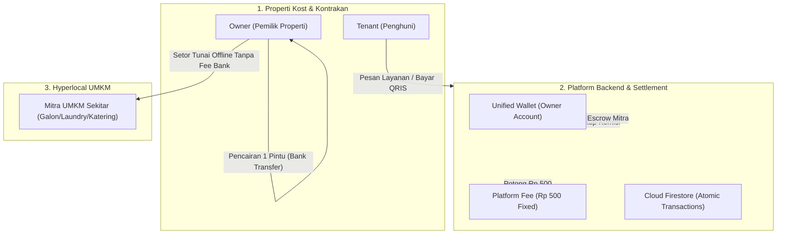
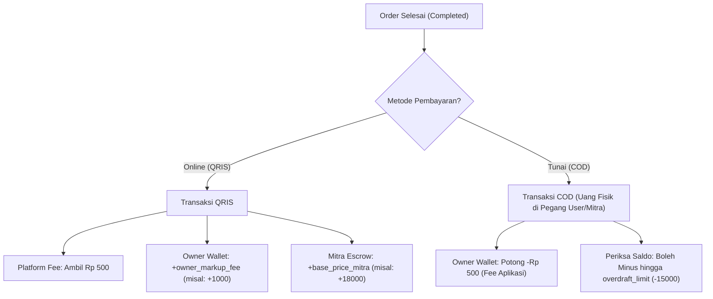

# TECHNICAL BLUEPRINT & SYSTEM SPECIFICATION
## Sistem Manajemen Properti (Kost/Kontrakan/Hotel) & Ekosistem Hyperlocal UMKM

* **Nama Proyek:** Sistem Manajemen Properti (Kost/Kontrakan/Hotel) & Ekosistem Hyperlocal UMKM
* **Database & Backend:** Firebase (Authentication, Cloud Firestore, Firebase Storage, Cloud Functions)
* **Payment Gateway:** Midtrans / Xendit (QRIS Dynamic API - Sandbox/Production)
* **Notifikasi Eksternal:** WhatsApp API / Deep Link (`wa.me`)
* **Dokumen Versi:** 1.0 (Production Architecture Standard)
* **Metodologi Pengembangan:** Clean Architecture & Reactive Serverless Event-Driven System

---

## 1. GAMBARAN UMUM ARSITEKTUR & MODEL BISNIS

Aplikasi ini menggunakan strategi **B2B2C** dengan pendekatan **Freemium SaaS Hook**:

* **Manajemen Sewa Kamar (Gratis 0% Komisi):** Digunakan sebagai *hook* utama untuk mengunci Owner properti agar beralih dari pencatatan manual ke platform. Mewajibkan seluruh penghuni (Tenant) mendaftar serta mengunggah KTP saat Check-in untuk validasi identitas hukum.
* **Monetisasi Harian (Hyperlocal UMKM):** Mengambil Platform Fee tetap sebesar **Rp500/transaksi** dari pemenuhan kebutuhan harian penghuni (Galon, Makanan, Laundry, Token Listrik) yang dipasok oleh Mitra UMKM sekitar lingkungan properti.
* **Pencairan Satu Pintu (Single-Node Settlement):** Seluruh perputaran dana (komisi Owner & uang titipan UMKM) dipusatkan pada **1 Dompet Terpadu (Unified Wallet)** milik Owner. Skema ini mengeliminasi beban biaya transfer bank ganda (multi-payout fees) dan memfasilitasi warung/mitra UMKM yang belum memiliki rekening bank (*unbanked*).



---

## 2. ROLE PENGGUNA (USER ROLES)

Sistem memiliki 4 role utama dengan kesiapan skalabilitas untuk tipe properti: **kost**, **kontrakan**, maupun **hotel**:

1. **`super_admin` (Platform Owner):**
   * Memantau seluruh metrik operasional dan rekapitulasi Platform Fee Rp500.
   * Mengaudit kepatuhan KYC KTP dan mengawasi kesehatan transaksi global.
   * Memvalidasi dan memproses pencairan dana (*withdraw*) ke rekening bank Owner.
2. **`owner` (Pemilik Kost/Properti):**
   * Mengelola unit kamar, inventaris, dan memvalidasi keaslian data KTP penghuni.
   * Mendaftarkan dan mengunci harga Mitra UMKM (*Price Lock*).
   * Mengatur *markup fee* komisi tambahan sesuai kebijakan pemilik.
   * Memantau saldo *Unified Wallet* (komisi bersih dan escrow mitra) serta mencairkan dana.
3. **`tenant` (Penghuni Kost):**
   * Melakukan proses *onboarding check-in* mandiri (input 16 digit NIK & unggah foto KTP).
   * Menjelajahi katalog produk/jasa UMKM sekitar kos.
   * Melakukan transaksi pembayaran via QRIS dinamis atau Tunai (COD).
   * Mengumpulkan poin loyalitas dan memberikan rating ulasan kepada Mitra.
4. **`mitra` (UMKM Lokal):**
   * Menerima pesanan masuk melalui Dashboard web ringan atau notifikasi WhatsApp otomatis.
   * Memproses dan mengantarkan pesanan langsung ke nomor kamar penghuni.
   * Menerima pembayaran: tunai langsung dari Tenant (COD) atau rekapitulasi setoran dari Owner (Online QRIS).

---

## 3. SKEMA DATABASE (CLOUD FIRESTORE)

Sistem menggunakan 5 koleksi inti (*collections*) terstruktur pada Cloud Firestore:

### A. Collection: users
Menyimpan data akun seluruh entitas pengguna lintas peran (*cross-role identity*).

```json
{
  "uid": "string (Document ID / Firebase Auth UID)",
  "role": "tenant | owner | mitra | super_admin",
  "name": "string",
  "phone": "string (format E.164 / 628xxx untuk integrasi WhatsApp)",
  "property_id": "string (referensi ke collection properties)",
  "room_number": "string (khusus tenant, contoh: A01, B02)",
  "loyalty_points": "number (default: 0, khusus tenant)",
  "kyc_data": {
    "nik": "string (16 digit angka tervalidasi)",
    "ktp_image_url": "string (path berkas di Firebase Storage)",
    "verified_status": "pending | verified | rejected",
    "rtrw_sync_status": "boolean (persiapan integrasi ekspor API RT/RW)"
  },
  "created_at": "timestamp"
}
```

### B. Collection: properties (Kost / Kontrakan / Hotel)
Menyimpan data fisik gedung properti serta saldo terpadu (*Unified Wallet*) milik Owner.

```json
{
  "property_id": "string (Document ID)",
  "owner_uid": "string (referensi ke users.uid)",
  "property_name": "string",
  "property_type": "kost | kontrakan | hotel",
  "address": "string",
  "wallet": {
    "owner_commission_balance": "number (Saldo bersih hak owner + kuota COD, default bonus awal: 25000)",
    "mitra_escrow_balance": "number (Total uang titipan UMKM dari transaksi Online/QRIS)",
    "overdraft_limit": "number (default: -15000, batas maksimal saldo minus sebelum fitur terkunci)"
  },
  "bank_account": {
    "bank_name": "string (BCA, Mandiri, BRI, BNI, dll.)",
    "account_number": "string",
    "account_holder": "string"
  }
}
```

### C. Collection: mitra_umkm
Menyimpan profil warung atau penyedia jasa hyperlocal yang terikat pada properti tertentu.

```json
{
  "mitra_id": "string (Document ID)",
  "property_id": "string (referensi ke properties.property_id)",
  "mitra_name": "string (contoh: Laundry Barokah, Depot Air Tirta)",
  "category": "galon | makanan | laundry | listrik",
  "whatsapp_number": "string (format 628xxx)",
  "rating_avg": "number (default: 5.0, skala 1.0 - 5.0)",
  "rating_count": "number (default: 0)",
  "timeout_cancel_count": "number (default: 0, pencatat batas toleransi pembatalan)",
  "is_active": "boolean (default: true)",
  "unsettled_balance": "number (total hak mitra yang belum disetor fisik oleh owner)"
}
```

### D. Collection: products
Menyimpan katalog item produk/layanan dengan mekanisme penguncian harga oleh Owner (*Price Lock*).

```json
{
  "product_id": "string (Document ID)",
  "mitra_id": "string (referensi ke mitra_umkm.mitra_id)",
  "property_id": "string (referensi ke properties.property_id)",
  "product_name": "string (contoh: Air Galon Aqua 19L + Pasang)",
  "base_price_mitra": "number (Harga dasar mitra termasuk ongkir, contoh: 18000)",
  "platform_fee": "number (Fixed platform fee: 500)",
  "owner_markup_fee": "number (Komisi tambahan diatur Owner, contoh: 1000)",
  "display_price_tenant": "number (Kalkulasi otomatis: base_price + platform_fee + owner_markup = 19500)",
  "sla_minutes": "number (Batas waktu toleransi pengantaran oleh mitra, contoh: 30)"
}
```

### E. Collection: orders
Menyimpan transaksi pemesanan kebutuhan harian penghuni dari pembuatan hingga penyelesaian.

```json
{
  "order_id": "string (Document ID)",
  "property_id": "string",
  "tenant_uid": "string",
  "room_number": "string",
  "mitra_id": "string",
  "items": [
    {
      "product_id": "string",
      "product_name": "string",
      "qty": "number",
      "unit_price": "number",
      "subtotal": "number"
    }
  ],
  "payment_method": "QRIS | COD",
  "qris_admin_fee": "number (contoh: 0 atau MDR fee)",
  "total_tenant_pay": "number",
  "order_status": "waiting_payment | pending_accept | processing | completed | cancelled_timeout",
  "sla_deadline_at": "timestamp (created_at + sla_minutes)",
  "rating_given": "number (skala 1 - 5, optional)",
  "created_at": "timestamp",
  "completed_at": "timestamp"
}
```

---

## 4. STEP-BY-STEP IMPLEMENTASI FITUR (UNTUK WORKER & DEVELOPER)

### TAHAP 1: Autentikasi, Upload KTP, & Firebase Security Rules

#### 1.1 Alur Registrasi & Check-in Tenant:
* Saat tenant pertama kali masuk ke kamar kost, formulir onboarding mewajibkan pengisian:
  * Nama Lengkap (sesuai KTP).
  * Nomor WhatsApp aktif.
  * Nomor Kamar yang dihuni.
  * 16 Digit Nomor Induk Kependudukan (NIK).
  * Unggah foto fisik KTP asli.
* **Validasi NIK:**
  * Wajib berupa 16 digit angka numerik murni.
  * Regex pattern: `^[0-9]{16}$`.

#### 1.2 Keamanan Data KTP (Storage & Firestore Security Rules):
* Berkas foto KTP disimpan pada path terisolasi: `ktp_uploads/{property_id}/{tenant_uid}.jpg`.
* Berkas KTP bersifat rahasia tingkat tinggi (*strictly confidential*). Hanya boleh dibaca oleh Tenant pemilik berkas dan Owner yang memiliki `property_id` terkait.

```javascript
rules_version = '2';
service firebase.storage {
  match /b/{bucket}/o {
    match /ktp_uploads/{propertyId}/{tenantUid}.jpg {
      allow read, write: if request.auth != null && 
        (request.auth.uid == tenantUid || 
         firestore.get(/databases/(default)/documents/properties/$(propertyId)).data.owner_uid == request.auth.uid);
    }
  }
}
```

---

### TAHAP 2: Logika "Unified Wallet" & Pembayaran (QRIS vs COD)

Gunakan **Firestore Transaction (`runTransaction`)** untuk menjamin mutasi saldo berjalan secara atomik tanpa risiko *race condition*:



#### Rumus Mutasi Saldo:
1. **Bayar Online (QRIS):**
   * Request API QRIS Dinamis (Midtrans / Xendit).
   * Saat webhook menyatakan transaksi sukses (`completed`):
     * Platform Fee: **Rp500** masuk ke revenue platform.
     * `wallet.owner_commission_balance` bertambah **+owner_markup_fee** (contoh: +Rp1.000).
     * `wallet.mitra_escrow_balance` bertambah **+base_price_mitra** (contoh: +Rp18.000).
2. **Bayar Tunai (COD):**
   * Uang tunai fisik langsung dipegang oleh Mitra/Owner di lokasi kost.
   * `wallet.owner_commission_balance` di Firestore otomatis dipotong **-Rp500** (pembayaran fee platform secara kredit).
3. **Mekanisme Proteksi Overdraft Limit (-15000):**
   * Saldo Owner Rp0 atau minus **TIDAK BOLEH** memblokir pesanan penghuni secara sepihak!
   * Sistem mengizinkan saldo komisi menjadi minus hingga batas toleransi `overdraft_limit` (**-Rp15.000**), setara dengan kuota 30 pesanan COD talangan.
   * **Sanksi Akhir Bulan:** Jika saldo masih minus saat rekapitulasi akhir bulan tiba, sistem mengunci sementara fitur cetak kuitansi sewa kamar dan blokir buka data KTP penghuni baru hingga Owner melunasi saldo minus via transfer/QRIS top-up.

---

### TAHAP 3: Pencairan Dana 1 Pintu (Single-Node Settlement)

Mekanisme pencairan terpadu untuk efisiensi biaya perbankan:
1. **Penarikan Dana Owner (Payout):** Owner mengajukan pencairan seluruh saldo `wallet.owner_commission_balance` dan `wallet.mitra_escrow_balance` ke nomor rekening bank miliknya (hanya dikenakan 1x biaya admin transfer bank).
2. **Penyaluran ke Mitra Offline:** Setelah dana masuk ke rekening pribadi, Owner menyerahkan uang titipan tunai kepada warung/mitra UMKM secara berkala (harian/mingguan).
3. **Reset Piutang Mitra:** Setelah uang fisik diserahkan, Owner menekan tombol `[Tandai Sudah Disetor ke Mitra]` di dashboard untuk mereset nilai `unsettled_balance` pada entitas mitra.

---

### TAHAP 4: Kontrol Kualitas Mitra (SLA Timer, WA Trigger, & Auto-Ranking)

1. **WhatsApp Instant Trigger:**
   * Setiap pesanan berstatus `pending_accept` otomatis memicu pengiriman pesan template ke nomor WhatsApp mitra via Cloud Functions / API WhatsApp / Deep Link `wa.me`:
     * *Format:* `"Halo [Nama Mitra], ada pesanan baru dari Kost [Nama Properti] Kamar [Nomor Kamar]: [Detail Item]. Mohon konfirmasi sebelum [SLA Time]."`
2. **SLA Countdown & Auto-Cancel:**
   * Cloud Function terjadwal (*Scheduled Cron*) memeriksa batas `sla_deadline_at`.
   * Jika mitra tidak menekan tombol terima pesanan sebelum tenggat waktu habis, pesanan otomatis berstatus `cancelled_timeout`.
   * Jika transaksi menggunakan QRIS, dana otomatis dikembalikan ke saldo anak kost atau diterbitkan voucher refund instan.
3. **Rating & Auto-Suspend:**
   * Daftar warung diurutkan otomatis berdasarkan nilai `rating_avg` tertinggi.
   * **Proteksi Kualitas:** Jika nilai `rating_avg < 3.5` atau `timeout_cancel_count >= 3`, sistem otomatis menonaktifkan akun warung (`is_active = false`) demi menjaga kenyamanan penghuni kost.

---

## 5. CHECKLIST HALAMAN UI

### A. Tenant (Anak Kost)
* [x] **Onboarding & Check-in Modal:** Formulir input Nama, No WA, Nomor Kamar, validasi NIK 16 digit, dan upload KTP.
* [x] **Home Dashboard:** Banner kost, katalog dinamis produk UMKM sekitar, saldo poin loyalitas, dan status kamar.
* [x] **Katalog & Checkout Modal:** Pilihan jumlah pesanan, opsi metode bayar (QRIS Dinamis / Tunai COD), dan rincian biaya.
* [x] **Tracking Order & SLA Timer:** Progress bar pengantaran real-time dan hitung mundur SLA.
* [x] **Modal Rating & Ulasan:** Bintang 1-5 dan masukan kepuasan layanan setelah pesanan selesai.

### B. Owner (Pemilik Kost)
* [x] **Manajemen Kamar & Hunian:** Pemetaan nomor kamar, status terisi/kosong, dan daftar data penghuni.
* [x] **Verifikasi KTP & Export RT/RW:** Pratinjau aman berkas KTP dan tombol 1-klik `[Export Data Wajib Lapor RT/RW]`.
* [x] **Kemitraan UMKM & Price Lock:** Pendaftaran warung sekitar, penguncian harga dasar (`base_price`), dan pengaturan `owner_markup_fee`.
* [x] **Unified Wallet Dashboard:** Tampilan grafik saldo komisi, saldo escrow mitra, histori mutasi QRIS/COD, indikator batas minus overdraft (-15.000), tombol `[Tarik Dana ke Rekening]`, dan tombol `[Tandai Sudah Disetor ke Mitra]`.

### C. Mitra UMKM (Warung Lokal)
* [x] **Dashboard Pesanan Ringkas:** Tampilan antarmuka responsif ramah ponsel untuk menerima atau menolak pesanan masuk.
* [x] **Rincian Alamat Antar:** Penayangan jelas nomor kamar dan nomor WhatsApp penghuni.
* [x] **Rekapitulasi Pendapatan:** Catatan pesanan selesai dan total piutang yang menunggu setoran dari Owner.

### D. Super Admin (Platform Owner)
* [x] **Monitoring Pendapatan Platform:** Akumulasi pendapatan fee tetap Rp500 per transaksi harian.
* [x] **Pengawasan Transaksi Global:** Pelacakan pesanan aktif, rasio pembayaran QRIS vs COD, dan log audit mutasi dompet.
* [x] **Pusat Pencairan Dana (Payout Processing):** Otorisasi transfer dana ke rekening bank Owner kost.
