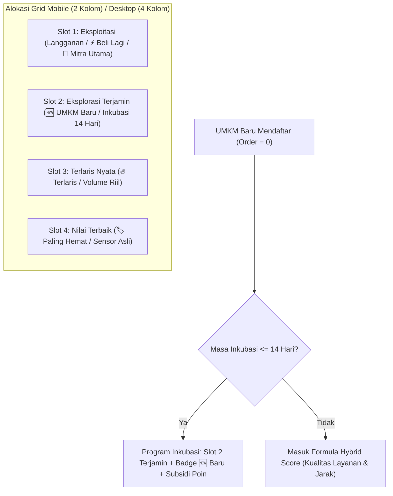
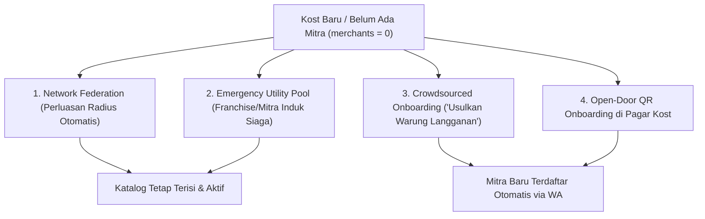

# Analisis & Solusi Keadilan Algoritmik: Bagaimana UMKM Baru & Kost Tanpa Mitra Tetap Mendapatkan Kesempatan yang Sama (Cold Start Resolution)

**Penulis:** Tim Engineering & Arsitektur Produk KostKu  
**Target Pembaca:** Mbak Rena (@RenartaCaylen / Oscar Herdian Wijaya) — FIK S1 Teknik Informatika UDINUS Semarang  
**Konteks Sistem:** Platform KostKu (Hyperlocal Tenant-Partner Marketplace)

---

## 1. Problem Statement: "The Matthew Effect" & Fenomena Cold Start

Dalam desain sistem rekomendasi dan *marketplace*, terdapat paradoks klasik yang disebut **The Matthew Effect** (*"The rich get richer, the poor get poorer"*):

1. **Jebakan Toko Lama (Incumbency Bias)**:
   Jika algoritma hanya mengandalkan badge `🔥 Terlaris (Xx Dipesan)` dan filter `⚡ Beli Lagi`, maka UMKM yang mendaftar lebih awal dan sudah mengumpulkan 100+ transaksi akan terus mendominasi peringkat teratas.
   * Dampak: UMKM baru yang baru buka tidak pernah dilihat oleh penghuni (*zero impression*), tidak pernah menerima pesanan (*zero conversion*), dan akhirnya menyerah atau keluar dari platform.
2. **Kondisi Kost Tanpa Mitra (Zero-Partner Cold Start)**:
   Ketika seorang pemilik kost baru mendaftarkan gedungnya di KostKu, atau kost berlokasi di area pemukiman baru di mana belum ada warung/depot yang diajak bermitra (`merchants.length === 0`):
   * Dampak: Halaman marketplace penghuni menjadi kosong melompong (*empty state*), kebutuhan primer (air minum, cuci baju) tidak terpenuhi, dan retensi aplikasi turun drastis.

Dokumen ini menyajikan arsitektur solusi sistematis untuk menjamin **keadilan eksposur bagi UMKM baru** dan **kontinjensi otomatis bagi kost tanpa mitra**.

---

## 2. Lima Mekanisme Keadilan bagi UMKM Baru (*Newcomer Fairness Engine*)

Agar UMKM baru tidak tenggelam oleh toko lama, KostKu merancang model alokasi berbasis **Exploration vs Exploitation (Multi-Armed Bandit)**:



---

### 1. Guaranteed Exploration Slot (Alokasi Slot Tampil Terjamin)

Alih-alih menyortir seluruh kartu murni dari volume penjualan, algoritma grid membagi slot tayang menjadi 2 fungsi:

* **Slot Eksploitasi (60% alokasi)**: Menampilkan toko yang sudah terbukti disukai (Mitra Utama & Riwayat Beli Lagi penghuni).
* **Slot Eksplorasi (40% alokasi)**: **Wajib mencadangkan minimal 1 slot di baris pertama/kedua khusus untuk toko baru** yang berusia kurang dari 14 hari di platform, terlepas dari jumlah penjualannya yang masih nol.
* Hasil: UMKM baru dijamin tampil di layar pertama (*above-the-fold*) setiap kali aplikasi dibuka oleh penghuni kost.

---

### 2. Badge & Identitas Khusus: `🆕 UMKM Baru (Pendatang Baru)`

Toko baru tidak boleh dibiarkan tanpa identitas di samping toko bertanda `🔥 Terlaris`. KostKu memberikan *trust-signal* alternatif:

* Badge: **`🆕 Baru di KostKu`** (Gradien Cyan-Biru Muda `#06b6d4` ke `#3b82f6`).
* Tooltip: *"Mitra baru di sekitar kostmu. Coba menu andalannya dan bantu UMKM lokal berkembang!"*
* Sub-label: Menampilkan *"Spesialis Menu Dapur"* atau *"Refill Bersih"* untuk menumbuhkan rasa ingin tahu penghuni.

---

### 3. Insentif Uji Coba: Subsidi Poin & Diskon Perdana (*Incentivized First-Trial*)

Untuk mengatasi keengganan anak kost mencoba toko yang belum memiliki reputasi:

* **Bonus Poin Ekstra**: Penghuni yang memesan di UMKM berlabel `🆕 Baru` mendapatkan reward **+150 Poin (1.5x lipat poin normal)**.
* **Subsidi 0% Platform Fee**: Selama 30 hari pertama, KostKu membebaskan biaya platform fee sehingga mitra baru dapat memasang harga promo perkenalan yang sangat kompetitif tanpa merugi.
* **Review Booster**: Pesanan pertama dari penghuni kost otomatis memicu prompt penilaian ringkas bintang 5 agar toko baru segera mendapatkan reputasi publik (*social proof*).

---

### 4. Formula Ranking Hibrida (Bukan Cuma Jumlah Penjualan)

Ranking tampilan normal tidak hanya menghitung `totalSold`, melainkan menggunakan formula **Composite Quality Score (CQS)**:

$$\text{Score} = w_1 \cdot \text{ProximityScore} + w_2 \cdot \text{NewcomerBoost} + w_3 \cdot \text{ServiceReadiness} + w_4 \cdot \log(1 + \text{totalSold})$$

Di mana:
* **$\text{ProximityScore}$**: Semakin dekat jarak fisik (< 150m), skor semakin tinggi. Toko baru yang berada tepat di sebelah kost otomatis mengalahkan toko lama yang berjarak 1 km.
* **$\text{NewcomerBoost}$**: Nilai bonus tetap sebesar $+40\text{ poin}$ yang aktif selama 14 hari pertama sejak UMKM diverifikasi, lalu meluruh secara eksponensial (*decay factor*).
* **$\text{ServiceReadiness}$**: Toko yang berstatus buka sekarang (`isOpen: true`), memiliki foto kamera asli (`isCameraVerified: true`), dan waktu respon cepat mendapat poin keunggulan.
* **$\log(1 + \text{totalSold})$**: Penggunaan fungsi logaritma mencegah toko dengan 1.000 pesanan memonopoli toko yang baru memiliki 10 pesanan (mengecilkan kesenjangan eksponensial).

---

### 5. Soft-Cap & Round-Robin Rotation (Anti-Monopoli Toko Terlaris)

Untuk mencegah satu toko terlaris muncul di posisi paling atas secara permanen sepanjang hari:

* Sistem menerapkan **Session-Based Rotation**: Jika dalam 3 kali buka aplikasi penghuni tidak mengeklik toko terlaris nomor 1, posisi teratas akan dirotasi sementara ke toko alternatif atau toko baru yang memiliki produk sejenis.

---

## 3. Empat Strategi Penanganan Saat Kost Tanpa Mitra Sama Sekali (*Zero-Partner State*)

Bagaimana jika suatu kost baru dibuat atau pemilik kost belum mendaftarkan satu pun mitra lokal (`merchants.length === 0`)?



---

### Strategi 1: Network Federation & Dynamic Radius Expansion (Perluasan Radius Otomatis)

Jika di database internal kost tersebut tidak ditemukan mitra utama (`kostUid === currentKostUid` menghasilkan 0 toko):

1. **Ekspansi Radius Cerdas (0.5 km $\rightarrow$ 1.5 km $\rightarrow$ 3.0 km)**:
   Sistem secara dinamis menarik data dari **Mitra Jaringan Kost Rekanan Sekitar** (`partnershipType: 'network'`) yang berada di kelurahan atau kecamatan yang sama.
2. **Label Transparan**:
   Kartu toko diberi penanda: `🌐 Mitra Jaringan Kost Rekanan (Binaan Kost Tetangga)` dengan estimasi waktu antar 15–25 menit.
3. **Hasil**: Layar penghuni tidak pernah kosong; kebutuhan galon dan laundry tetap terlayani sejak hari pertama kost beroperasi.

---

### Strategi 2: Emergency Utility Fallback (Pool Sentralisasi Layanan Pokok)

Untuk kebutuhan yang tidak bisa ditunda (air minum habis atau pakaian kotor menumpuk), KostKu menyediakan **Mitra Default Standar (Hub Pool)**:

* **Depot Air & Gas Standar Konsorsium**: Terhubung dengan depot resmi air mineral (Aqua / Vit / Le Minerale) yang memiliki armada pengantaran wilayah kecamatan terkait.
* **Laundry Kiloan Drop-Point**: Staf kost bertindak sebagai titik kumpul sementara (*drop-point*) yang bekerja sama dengan vendor laundry kiloan terdekat hingga ada warung mandiri yang mendaftar.

---

### Strategi 3: Crowdsourced Onboarding — "Usulkan Warung Langgananmu"

Menghadirkan fitur partisipatif langsung di dashboard penghuni ketika pilihan toko masih sedikit:

```
┌─────────────────────────────────────────────────────────────┐
│ 💡 Punya Warung atau Depot Langganan di Dekat Kost?         │
│ Masukkan nama & nomor WhatsApp warung langgananmu di sini.   │
│ Kami akan bantu mereka berjualan di KostKu.                 │
│ 🎁 Dapatkan 500 Poin (Rp 5.000) saat warungmu resmi aktif!  │
│ [ Input No. WA Warung ] [ 🚀 Ajak Bergabung ]               │
└─────────────────────────────────────────────────────────────┘
```

* **Alur Otomatisasi WhatsApp Bot**:
  Saat nomor dikirimkan, bot KostKu otomatis mengirimkan undangan ramah ke pemilik warung:
  > *"Halo Bu Siti! Penghuni Kost Dago Asri ingin pesan makanan dari warung Ibu lewat aplikasi KostKu tanpa potongan komisi ojol. Klik tautan ini untuk aktifkan toko dalam 2 menit: [link]"*
* Mengubah penghuni kost menjadi "agen akuisisi lapangan" yang sangat efektif karena mereka tahu persis warung mana yang enak dan murah di sekitar kost.

---

### Strategi 4: Open-Door QR Onboarding di Pagar/Lobi Kost

Pemilik kost cukup menempelkan stiker QR resmi KostKu di gerbang atau papan mading kost:

* Tulisan pada stiker: *"Anda Pedagang Warung, Galon, atau Laundry Sekitar Kost Ini? Scan untuk Jadi Mitra Resmi Penghuni Kost."*
* Pedagang keliling atau pemilik warung yang lewat bisa langsung mendaftarkan tokonya sendiri via *mobile web form* sederhana (cukup foto KTP, foto toko, dan daftar menu).

---

## 4. Matriks Perbandingan: Pendekatan Ojol vs Pendekatan Berkeadilan KostKu

| Aspek Penilaian | Aplikasi Ojol Konvensional | Sistem Berkeadilan KostKu |
| :--- | :--- | :--- |
| **Peluang UMKM Baru** | Hampir nol tanpa pasang iklan (*Pay-to-Win*) | **Tersedia Slot Eksplorasi Terjamin (Slot 2)** |
| **Biaya Promosi Awal** | Harus potong harga + biaya komisi 20-30% | **0% Platform Fee 30 Hari + Subsidi Poin Penghuni** |
| **Kondisi Tanpa Mitra** | Menampilkan resto jauh (ongkir mahal Rp 20.000) | **Network Federation antar-kost + Pool Layanan Pokok** |
| **Sumber Akuisisi Mitra** | Sales korporat / pendaftaran kantor cabang rumit | **Crowdsourcing Penghuni Kost via WhatsApp Bot & Stiker QR** |
| **Keterbukaan Data** | Algoritma *black-box* berorientasi keuntungan iklan | **Ranking transparan berbasis kedekatan fisik & kesiapan layanan** |

---

## 5. Rencana Integrasi Kode Program (Technical Roadmap)

Untuk merealisasikan arsitektur ini ke dalam sistem KostKu yang sedang berjalan:

1. **Implementasi Slot Eksplorasi di [UserDashboard.jsx](file:///home/rena/.gemini/antigravity/scratch/kostku/src/pages/UserDashboard.jsx)**:
   * Menambahkan logika pemisahan `newMerchants = list.filter(m => isNewcomer(m))` dan menyisipkan 1 kartu UMKM baru pada indeks ke-1 atau ke-2 dalam array grid render.
2. **Badge Baru di [MitraGridCard](file:///home/rena/.gemini/antigravity/scratch/kostku/src/pages/UserDashboard.jsx)**:
   * Menambahkan kondisi: jika `m.isNewcomer || m.createdAt < 14_DAYS`, render badge `🆕 Baru`.
3. **Banner Crowdsourced di Kondisi Kosong**:
   * Jika `list.length === 0` atau `merchants.length <= 1`, render banner *"Usulkan Warung Langgananmu (Bonus 500 Poin)"* di bawah filter kategori.
4. **Endpoint Network Federation di [backend/server.js](file:///home/rena/.gemini/antigravity/scratch/kostku/backend/server.js)**:
   * Memperluas query fallback `/api/merchants` agar otomatis mencari UMKM dari kost rekanan terdekat jika kost aktif belum memiliki mitra lokal.

---

## 6. Kesimpulan

Dengan memadukan **Guaranteed Exploration Slot**, **Newcomer Boost**, dan **Network Federation**, KostKu memastikan bahwa:
1. **UMKM baru tidak dianaktirikan** dan memiliki peluang nyata mendapatkan pelanggan setia sejak hari pertama.
2. **Penghuni kost tidak pernah mengalami "kekosongan layanan"**, bahkan saat kost baru pertama kali beroperasi.
3. **Pemilik kost terbantu** dalam memperluas fasilitas gedung tanpa harus repot mencari pedagang secara manual.
