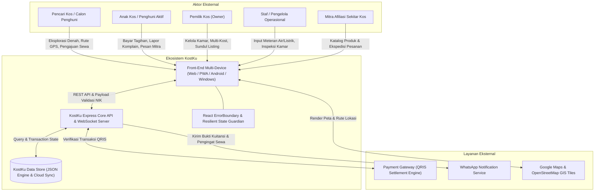
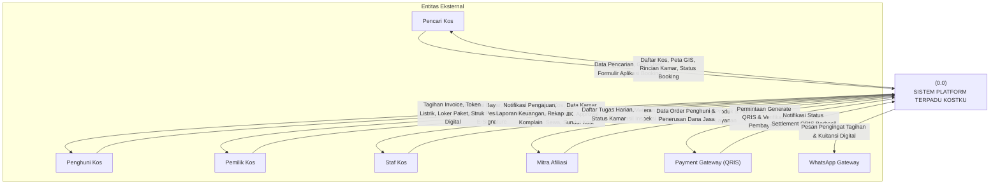
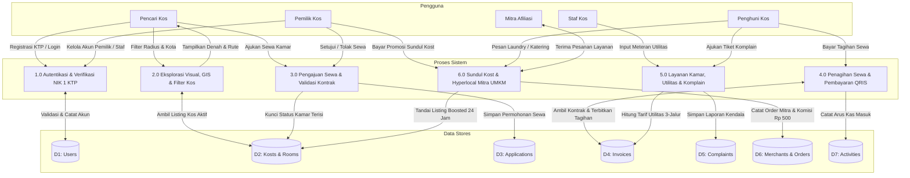
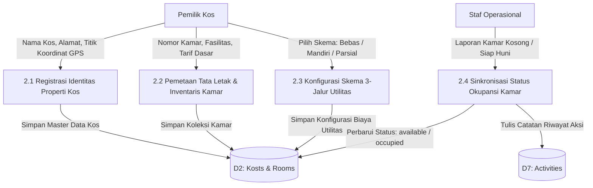
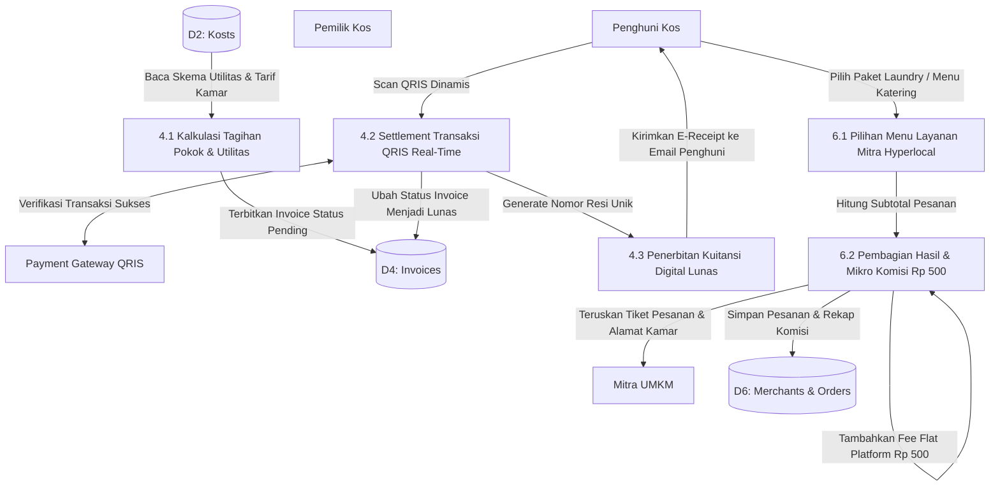
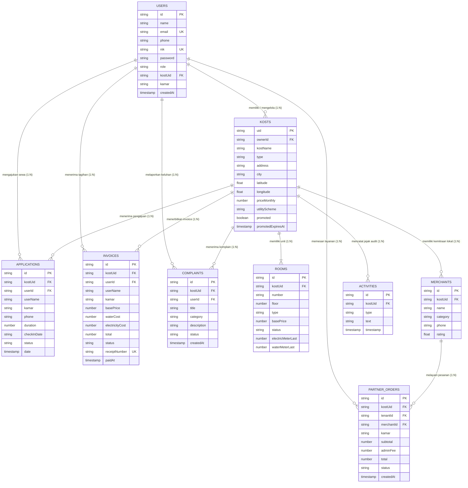

# MASTER TECHNICAL & DESIGN BLUEPRINT: KOSTKU PLATFORM
## Arsitektur Sistem, Kodingan, Skema Basis Data, Flowchart, dan Desain UI/UX

**Program Studi S1 Teknik Informatika, Fakultas Ilmu Komputer**  
**Universitas Dian Nuswantoro (UDINUS) Semarang**  
**Dokumen Klasifikasi:** *Master Technical Architecture Blueprint*  
**Versi Dokumen:** `2.0 (Revisi G - Final Production)` | **Tanggal Rilis:** 16 Oktober 2026  
**Tim Pengembang & Penulis:**
1. **Oscar Herdian Wijaya** (NIM: A11.2025.16309)
2. **Yohanes Aryo Suryo Rahardjo** (NIM: A11.2025.16479)
3. **M. Mirza Fadilah** (NIM: A11.2025.16354)

---

## DAFTAR ISI BLUEPRINT
1. **BAB I: Arsitektur Kodingan & Rekayasa Perangkat Lunak**
   - 1.1 Struktur Monorepo Multi-Platform (Web, Mobile, Desktop, Backend)
   - 1.2 Lapisan Front-End (React 18, Vite 5, Router, State Context, Canvas 3D & 2D)
   - 1.3 Lapisan Back-End REST API (Node.js, Express, Nodemailer, Security Guards)
   - 1.4 Mekanisme Kompilasi Multi-Platform (Capacitor Android APK & Electron Desktop)
   - 1.5 Standar Keamanan, Validasi NIK 16-Digit & Penanganan ErrorBoundary
2. **BAB II: Skema & Desain Basis Data**
   - 2.1 Arsitektur Penyimpanan Atomic JSON Document-Store
   - 2.2 Kamus Data Lengkap (Data Dictionary) 9 Entitas Utama
   - 2.3 Matriks Relasi Entitas & Kardinalitas Data
3. **BAB III: Diagram Alir & Flowchart Sistem**
   - 3.1 Diagram Arsitektur Terpadu
   - 3.2 Diagram Konteks Sistem (Level 0)
   - 3.3 Data Flow Diagram (DFD) Level 1
   - 3.4 Data Flow Diagram (DFD) Level 2.1: Manajemen Kamar & Properti
   - 3.5 Data Flow Diagram (DFD) Level 2.2: Transaksi Sewa & Mitra Afiliasi
   - 3.6 Entity Relationship Diagram (ERD) Basis Data
   - 3.7 Flowchart Alur Pengguna (User Flows)
     - 3.7.1 Alur Booking & QRIS Payment
     - 3.7.2 Alur Sundul Kost Promoted Boost (24 Jam)
     - 3.7.3 Alur Mitra Afiliasi UMKM Hyperlocal (Fee Rp 500)
     - 3.7.4 Alur Utilitas Skema 3-Jalur (Listrik & Air)
4. **BAB IV: Desain Antarmuka & Sistem Desain UI/UX**
   - 4.1 Filosofi Desain Taste-Skill Anti-Slop & Blue Hour Palette
   - 4.2 Sistem Tipografi & Token Desain
   - 4.3 Pola Tata Letak Responsif (Desktop Sidebar, Glassmorphism Nav, Mobile Bottom Bar)
   - 4.4 Integrasi Kanvas Interaktif: Three.js WebGL & Video Scrubbing 60 FPS
   - 4.5 Katalog Komponen UI Baku (Cards, Badges, Modals, Forms, Map Pins)
5. **BAB V: Katalog Fitur Lengkap & Matriks Evolusi**
   - 5.1 Matriks Evolusi Lengkap: Ditambahkan, Diubah, Dihapus (Revisi A-G)
   - 5.2 Model Monetisasi Berkelanjutan & Tanpa Beban Pemilik Kost
   - 5.3 Ringkasan Pengujian Kualitas & Verifikasi Otomatis

---

# BAB I: Arsitektur Kodingan & Rekayasa Perangkat Lunak

## 1.1 Struktur Monorepo Multi-Platform
Sistem KostKu dirancang menggunakan arsitektur monorepo modular yang memisahkan antara *presentation layer*, *API core*, *desktop wrapper*, dan *native mobile container* dalam satu repositori kerja yang kohesif:

```
kostku/
├── android/                   # Native Android Container (Capacitor Bridge & Gradle)
│   ├── app/src/main/
│   │   ├── java/id/kostku/app/BridgeActivity.java
│   │   ├── res/               # Android App Icons, Splash Screen & Manifest
│   │   └── AndroidManifest.xml
│   └── build.gradle
├── backend/                   # REST API Core & Data Layer
│   ├── server.js              # Express.js REST Core (CRUD, Auth, Invoices, Sundul, Nodemailer)
│   ├── db.json                # Atomic JSON Persistent Document Store
│   └── package.json
├── electron/                  # Desktop Runtime Wrapper
│   └── main.cjs               # Electron Main Process, Window Management & IPC Bridge
├── public/                    # Static Assets & PWA Engine
│   ├── sw.js                  # Service Worker Caching & Offline Support
│   ├── manifest.json          # PWA Manifest (Standalone Web App Config)
│   └── icon-512.png
├── src/                       # Front-End Application (React 18 + Vite 5)
│   ├── components/            # UI Components & Interactive Widgets
│   │   ├── 3d/                # Three.js WebGL 3D Canvas (KostBuilding, KostScene)
│   │   ├── ErrorBoundary.jsx  # Global Crash Prevention Wrapper
│   │   ├── VideoScroll.jsx    # 60 FPS Canvas Video Scrubbing Controller
│   │   ├── AutoUpdateModal.jsx# Universal In-App Update Engine
│   │   └── Navbar.jsx, Sidebar.jsx, BottomNav.jsx
│   ├── context/               # Global State Management
│   │   ├── AuthContext.jsx    # Sesi Akun, Role, & Token Persistence
│   │   └── KostContext.jsx    # Multi-Kost State & Kamar Selector
│   ├── pages/                 # Route Views (Home, CariKost, DetailKost, Dashboard, dll.)
│   ├── services/api.js        # Axios/Fetch API Client & Error Interceptor
│   └── App.jsx, main.jsx      # Entrypoint & Declarative Router
├── scripts/                   # Automated Verification & Build Tooling
│   ├── md_to_docx.py          # Generator Word DOCX Resmi UDINUS
│   ├── md_to_html.py          # Generator Standalone HTML Viewer
│   └── render_mermaid_to_png.mjs # Engine Render Diagram Vektor Puppeteer
└── docs/                      # Dokumentasi Resmi & Aset Grafis
```

## 1.2 Lapisan Front-End (React 18, Vite 5, Router & State Management)
* **Single Page Application (SPA):** Menggunakan React 18 dengan pendekatan fungsional murni (*Functional Components*) dan *Hooks* (`useState`, `useEffect`, `useContext`, `useMemo`, `useCallback`).
* **Vite 5 Bundler:** Menyediakan *Hot Module Replacement (HMR)* sub-detik serta kompilasi produksi modular dengan *tree-shaking* agresif.
* **Declarative Routing:** Dikelola oleh `react-router-dom` v6, membagi rute publik (`/`, `/cari-kost`, `/kost/:id`, `/login`, `/register`) dan rute terproteksi (`/dashboard/owner`, `/dashboard/tenant`, `/dashboard/staff`, `/pengaturan`).
* **Global ErrorBoundary:** Membungkus seluruh hierarki rute. Jika terjadi galat runtime tak terduga (*unexpected unhandled exception*), aplikasi tidak mengalami layar putih kosong (*blank screen*), melainkan menampilkan antarmuka pemulihan dengan tombol *soft reload*.

## 1.3 Lapisan Back-End REST API (Node.js & Express)
Server back-end diimplementasikan pada `backend/server.js` dengan karakteristik:
* **Stateless RESTful Endpoints:**
  * `POST /api/auth/register`: Mendaftarkan akun baru dengan validasi ketat 1 KTP 1 NIK 16 digit.
  * `POST /api/auth/login`: Autentikasi kredensial pengguna dan penerbitan sesi peran.
  * `GET/POST /api/kosts`: Pengelolaan data properti kost dan pengaturan skema utilitas.
  * `GET/POST /api/rooms`: Manajemen unit kamar, penetapan harga dasar, dan status ketersediaan.
  * `POST /api/applications`: Pengajuan sewa kamar oleh calon penyewa.
  * `POST /api/invoices`: Pembuatan tagihan sewa bulanan dan verifikasi pelunasan QRIS.
  * `POST /api/complaints`: Pelaporan kerusakan kamar disertai foto bukti dan pembaruan status.
  * `GET/POST /api/merchants`: Katalog kemitraan hyperlocal UMKM sekitar kos.
  * `POST /api/partner-orders`: Pencatatan transaksi pemesanan layanan mitra dengan komisi flat Rp 500.
  * `POST /api/sundul`: Pembayaran promosi "Sundul Kost" slot #1 berdurasi 24 jam.
* **Dynamic Automated E-Receipt (Nodemailer):** Mengirimkan kuitansi digital otomatis berdesain profesional langsung ke email penyewa saat transaksi berstatus lunas (`paid`).

## 1.4 Mekanisme Kompilasi Multi-Platform
* **Mobile Android (Capacitor v8):** Aset web hasil kompilasi `dist/` disinkronisasikan ke folder Android native (`android/app/src/main/assets/public/`). `BridgeActivity.java` memuat web view berperforma tinggi dengan akses penuh ke perangkat keras GPS dan kamera.
* **Desktop Windows & Linux (Electron v44):** `electron/main.cjs` memuat antarmuka sistem lokal dengan menu kustom, tray bar, serta pengemasan installer satu klik (`.exe` NSIS dan Linux AppImage) melalui `electron-builder`.
* **Progressive Web App (PWA):** `public/sw.js` menerapkan strategi *stale-while-revalidate* untuk aset statis sehingga aplikasi dapat dibuka seketika saat jaringan internet padam.

---

# BAB II: Skema & Desain Basis Data

## 2.1 Arsitektur Penyimpanan Atomic JSON Document-Store
KostKu menggunakan engine penyimpanan berkas terstruktur atomic (`backend/db.json`) yang menjamin:
1. **Thread-Safe Atomic Write:** Setiap pembaruan data ditulis ke berkas temporer sebelum di-rename secara atomik, mencegah korupsi data saat server mendadak mati.
2. **Multi-Tenant Isolation:** Seluruh entitas anak (`rooms`, `applications`, `invoices`, `complaints`, `activities`) terikat kuat dengan kunci partisi `kostUid` dan `ownerId`.
3. **Audit Trail Logging:** Setiap operasi penambahan kamar, pergantian harga, perubahan status komplain, dan pelunasan tercatat dalam koleksi `activities`.

## 2.2 Kamus Data Lengkap (Data Dictionary) 9 Entitas Utama

### 1. Entitas `USERS`
Menyimpan data identitas kredensial seluruh pengguna sistem:
* `id` (String / Number, Primary Key): ID unik akun pengguna.
* `name` (String, Mandatory): Nama lengkap sesuai kartu tanda penduduk (KTP).
* `email` (String, Unique, Mandatory): Alamat email resmi untuk notifikasi dan e-receipt.
* `phone` (String, Mandatory): Nomor WhatsApp aktif untuk konfirmasi tagihan.
* `nik` (String[16], Unique, Mandatory): Nomor Induk Kependudukan 16 digit.
* `password` (String, Mandatory): Hash kata sandi terenkripsi.
* `role` (Enum, Mandatory): Peran pengguna (`owner` | `user` | `staff` | `master`).
* `kostUid` (String, Optional, Foreign Key -> `KOSTS.uid`): ID properti kos tempat pengguna bernaung.
* `kamar` (String, Optional): Nomor unit kamar yang dihuni (khusus peran `user`).
* `avatar` (String, Optional): URL foto profil pengguna.
* `createdAt` (Timestamp): Waktu registrasi akun.

### 2. Entitas `KOSTS`
Menyimpan profil properti indekos:
* `uid` (String, Primary Key): Kode unik properti (contoh: `KOST-JAKSEL-01`).
* `ownerId` (String / Number, Mandatory, Foreign Key -> `USERS.id`): ID pemilik sah kos.
* `kostName` (String, Mandatory): Nama komersial indekos.
* `type` (Enum): Tipe kos (`putra` | `putri` | `campur`).
* `address` (String, Mandatory): Alamat fisik lengkap properti kos.
* `city` (String, Mandatory): Kota/kabupaten domisili kos.
* `location` (Object {lat: Float, lng: Float}): Koordinat GPS geolokasi presisi.
* `priceMonthly` (Number, Mandatory): Harga sewa bulanan dasar kamar standar.
* `images` (Array of Strings): Daftar URL foto tampak depan dan fasilitas kos.
* `utilityScheme` (Enum): Skema pembebanan utilitas (`all_kost` | `electric_mandiri` | `water_mandiri` | `all_mandiri`).
* `promoted` (Boolean): Status keaktifan promosi prioritas sundul kost.
* `promotedExpiresAt` (Timestamp, Optional): Waktu kedaluwarsa slot sundul kost 24 jam.

### 3. Entitas `ROOMS`
Menyimpan unit-unit kamar fisik di setiap properti kos:
* `id` (String / Number, Primary Key): ID unik unit kamar.
* `kostUid` (String, Mandatory, Foreign Key -> `KOSTS.uid`): ID kos pemilik kamar.
* `number` (String, Mandatory): Nomor atau kode pintu kamar (contoh: `A01`, `B02`).
* `floor` (Number): Posisi lantai kamar (Lantai 1, 2, atau 3).
* `type` (String): Tipe kamar (`Standard`, `Deluxe`, `VIP Suite`).
* `basePrice` (Number, Mandatory): Harga sewa nominal kamar per bulan.
* `status` (Enum, Mandatory): Status ketersediaan (`available` | `occupied`).
* `facilities` (Array of Strings): Daftar fasilitas kamar (AC, Kasur, Kamar Mandi Dalam, WiFi).
* `electricMeterLast` (Number): Angka meteran listrik terakhir yang tercatat.
* `waterMeterLast` (Number): Angka meteran air PDAM terakhir yang tercatat.

### 4. Entitas `APPLICATIONS`
Menyimpan formulir pengajuan sewa dari calon penyewa:
* `id` (String / Number, Primary Key): ID unik pengajuan sewa.
* `kostUid` (String, Mandatory, Foreign Key -> `KOSTS.uid`): Kos tujuan pengajuan sewa.
* `userId` (String / Number, Mandatory, Foreign Key -> `USERS.id`): ID akun pemohon sewa.
* `userName` (String, Mandatory): Nama pemohon sewa.
* `kamar` (String, Mandatory): Nomor kamar yang diminati pemohon.
* `phone` (String, Mandatory): Nomor WhatsApp pemohon.
* `duration` (Number): Durasi masa sewa yang diajukan (dalam hitungan bulan).
* `checkInDate` (Date String): Rencana tanggal mulai menempati kamar kos.
* `notes` (String, Optional): Pesan khusus atau catatan tambahan dari pemohon.
* `status` (Enum, Mandatory): Status persetujuan (`pending` | `approved` | `rejected`).
* `date` (Timestamp): Tanggal pengajuan dibuat.

### 5. Entitas `INVOICES`
Menyimpan data tagihan keuangan sewa dan utilitas kamar:
* `id` (String / Number, Primary Key): ID unik faktur tagihan.
* `kostUid` (String, Mandatory, Foreign Key -> `KOSTS.uid`): ID kos penerbit tagihan.
* `userId` (String / Number, Mandatory, Foreign Key -> `USERS.id`): ID penghuni yang ditagih.
* `userName` (String, Mandatory): Nama lengkap penghuni.
* `kamar` (String, Mandatory): Nomor kamar yang dikenakan tagihan.
* `basePrice` (Number, Mandatory): Biaya sewa pokok bulanan kamar.
* `deposit` (Number): Biaya uang jaminan/deposit awal masuk (jika ada).
* `waterCost` (Number): Biaya pemakaian air PDAM berdasarkan angka meteran.
* `electricityCost` (Number): Biaya token/kwh listrik prabayar atau pascabayar.
* `convenienceFee` (Number): Biaya administrasi pemeliharaan platform.
* `total` (Number, Mandatory): Total akumulasi tagihan yang wajib dibayar.
* `status` (Enum, Mandatory): Status pelunasan tagihan (`pending` | `paid`).
* `receiptNumber` (String, Unique): Nomor seri kuitansi resmi pelunasan (contoh: `INV-20261016-001`).
* `paymentMethod` (String): Metode pembayaran yang digunakan (`QRIS`, `Bank Transfer`).
* `paidAt` (Timestamp, Optional): Waktu penyelesaian transaksi pembayaran.

### 6. Entitas `COMPLAINTS`
Menyimpan tiket keluhan atau laporan kendala fasilitas indekos:
* `id` (String / Number, Primary Key): ID tiket laporan kendala.
* `kostUid` (String, Mandatory, Foreign Key -> `KOSTS.uid`): ID kos lokasi kendala.
* `userId` (String / Number, Mandatory, Foreign Key -> `USERS.id`): ID penghuni pelapor.
* `userName` (String, Mandatory): Nama penghuni pelapor.
* `kamar` (String, Mandatory): Nomor kamar pelapor.
* `category` (Enum): Kategori kendala (`ac` | `plumbing` | `listrik` | `kebersihan` | `lainnya`).
* `title` (String, Mandatory): Ringkasan judul masalah.
* `description` (String, Mandatory): Penjelasan detail kerusakan atau kendala.
* `photoUrl` (String, Optional): URL foto bukti fisik kerusakan fasilitas.
* `status` (Enum, Mandatory): Siklus penanganan (`diajukan` | `diproses` | `selesai`).
* `createdAt` (Timestamp): Waktu pembuatan laporan.
* `updatedAt` (Timestamp): Waktu pembaruan terakhir penanganan kendala.

### 7. Entitas `MERCHANTS`
Menyimpan profil mitra usaha UMKM hyperlocal di sekitar lingkungan kos:
* `id` (String / Number, Primary Key): ID unik entitas mitra usaha.
* `kostUid` (String, Mandatory, Foreign Key -> `KOSTS.uid`): Kos asosiasi mitra lokal.
* `name` (String, Mandatory): Nama toko atau usaha (contoh: *Laundry Barokah Express*).
* `category` (Enum): Kategori bidang usaha (`laundry` | `catering` | `galon_air` | `cleaning`).
* `phone` (String, Mandatory): Nomor WhatsApp kontak pemesanan mitra.
* `location` (String): Alamat atau jarak toko dari lokasi indekos.
* `rating` (Float): Skor ulasan kepuasan layanan pelanggan (skala 1.0 - 5.0).
* `menuItems` (Array of Objects): Daftar menu layanan `[{ id, name, price, unit }]`.

### 8. Entitas `PARTNER_ORDERS`
Menyimpan transaksi pemesanan layanan mitra oleh penghuni kost:
* `id` (String / Number, Primary Key): ID pesanan layanan mitra.
* `kostUid` (String, Mandatory, Foreign Key -> `KOSTS.uid`): ID properti kos pemesan.
* `tenantId` (String / Number, Mandatory, Foreign Key -> `USERS.id`): ID penghuni pemesan.
* `tenantName` (String, Mandatory): Nama penghuni pemesan.
* `kamar` (String, Mandatory): Nomor kamar tujuan pengantaran pesanan.
* `merchantId` (String / Number, Mandatory, Foreign Key -> `MERCHANTS.id`): ID mitra terpilih.
* `merchantName` (String, Mandatory): Nama mitra yang melayani pesanan.
* `items` (Array of Objects): Rincian item pesanan `[{ name, qty, price, subtotal }]`.
* `subtotal` (Number, Mandatory): Total biaya murni pesanan barang/jasa.
* `adminFee` (Number, Fixed): Biaya administrasi platform sebesar tepat **Rp 500**.
* `total` (Number, Mandatory): Akumulasi `subtotal + adminFee`.
* `status` (Enum): Status pengiriman (`menunggu` | `diproses` | `dikirim` | `selesai`).
* `createdAt` (Timestamp): Waktu pesanan diajukan oleh penghuni.

### 9. Entitas `ACTIVITIES`
Menyimpan catatan riwayat peristiwa penting (*audit logs*) per properti kos:
* `id` (String / Number, Primary Key): ID catatan aktivitas.
* `kostUid` (String, Mandatory, Foreign Key -> `KOSTS.uid`): ID kos pemilik rekaman jejak.
* `type` (Enum): Klasifikasi aksi (`pengguna` | `keuangan` | `pengaturan` | `komplain`).
* `text` (String, Mandatory): Deskripsi naratif tindakan yang dilakukan pengguna.
* `timestamp` (Timestamp): Waktu pencatatan jejak audit secara otomatis.

---

# BAB III: Diagram Alir & Flowchart Sistem

## 3.1 Diagram Arsitektur Terpadu
Diagram berikut mendeskripsikan interaksi antara aktor eksternal, komponen internal KostKu, dan layanan API pihak ketiga:



## 3.2 Diagram Konteks Sistem (Level 0)
Diagram konteks menggambarkan batasan sistem KostKu dengan 7 entitas eksternal:



## 3.3 Data Flow Diagram (DFD) Level 1
DFD Level 1 menjabarkan 6 proses operasional inti beserta 7 penyimpan data (*data stores*):



## 3.4 Data Flow Diagram (DFD) Level 2.1: Manajemen Kamar & Properti



## 3.5 Data Flow Diagram (DFD) Level 2.2: Transaksi Sewa & Mitra Afiliasi



## 3.6 Entity Relationship Diagram (ERD) Basis Data



## 3.7 Flowchart Alur Pengguna (User Flows)

### 3.7.1 Alur Booking & QRIS Payment
Alur pendaftaran sewa hingga penerbitan token akses kamar:
1. **Pencarian & Penemuan:** Pencari kos memfilter lokasi melalui Leaflet GIS dan eksplorasi visual kamar.
2. **Pengajuan Sewa:** Pengguna mengisi durasi sewa, tanggal masuk, dan mengunggah dokumen NIK.
3. **Approval Pemilik:** Pemilik kos menerima notifikasi dan meninjau data permohonan sewa.
4. **Penerbitan Invoice:** Saat disetujui, sistem menerbitkan faktur tagihan dan mengunci status kamar menjadi `occupied`.
5. **Pembayaran QRIS:** Penghuni memindai barcode QRIS terverifikasi dan menyelesaikan transfer dana.
6. **Settlement & Akses:** Sistem memvalidasi pelunasan, menerbitkan e-receipt ke email, serta menayangkan token listrik dan kode akses pintu kamar.

### 3.7.2 Alur Sundul Kost Promoted Boost (24 Jam)
Alur monetisasi promosi prioritas kamar kosong bagi pemilik kost:
1. **Pemilihan Unit:** Pemilik kos membuka dashboard dan memilih properti yang memiliki kamar kosong (*vacant*).
2. **Pemesanan Paket:** Memilih opsi "Sundul Kost" (tarif mikro Rp 5.000 / 24 jam penayangan).
3. **Pembayaran Instan:** Scan kode QRIS transaksi resmi.
4. **Aktivasi Boost:** Kolom `promoted` pada entitas `KOSTS` bernilai `true` selama 24 jam ke depan. Listing otomatis menempati posisi slot #1 di beranda dan hasil pencarian dengan badge emas bersinar.

### 3.7.3 Alur Mitra Afiliasi UMKM Hyperlocal (Fee Rp 500)
Mekanisme pemesanan kebutuhan harian penghuni kost:
1. **Pendeteksian Hyperlocal:** Sistem memeriksa apakah terdapat mitra UMKM terdaftar di radius lingkungan indekos.
2. **Pilihan Bebas Penghuni:** Katalog hanya tampil jika ada mitra aktif; penghuni bebas membandingkan harga laundry/katering antar-mitra.
3. **Perhitungan Transparan:** Sistem menghitung subtotal murni barang/jasa ditambah fee administrasi mikro tepat **Rp 500** per transaksi.
4. **Disposisi Pesanan:** Notifikasi langsung dikirimkan ke WhatsApp mitra penjual dengan rincian nomor kamar pemesan untuk pengantaran langsung ke pintu kamar.

### 3.7.4 Alur Utilitas Skema 3-Jalur (Listrik & Air)
Otomasi penagihan utilitas secara adil:
1. **Pencatatan Meteran:** Staf atau pemilik menginput angka meteran fisik air/listrik di awal bulan.
2. **Kalkulasi Selisih:** Sistem menghitung selisih pemakaian kubikasi/kwh dikalikan tarif per unit.
3. **Penerapan Skema:**
   * *All-Kost:* Seluruh biaya utilitas telah digabung ke harga pokok kamar.
   * *Mandiri:* Tagihan air/listrik ditambahkan secara terpisah ke dalam faktur bulanan penghuni.
   * *Parsial:* Listrik mandiri via nomor token PLN prabayar, sedangkan air ditanggung pemilik.

---

# BAB IV: Desain Antarmuka & Sistem Desain UI/UX

## 4.1 Filosofi Desain Taste-Skill Anti-Slop & Blue Hour Palette
Antarmuka KostKu dibangun dengan standar **Anti-Slop Visual Design System** yang menolak tampilan seragam AI generik. Mengusung tema atmosferik **Blue Hour (Civil Twilight)** yang memadukan ketenangan malam kota dengan kehangatan cahaya lampu kamar:

| Token Warna | Nilai Hex | Fungsi & Semantik Desain |
|---|---|---|
| **Primary Navy** | `#1E3A8A` | Warna dominan navigasi, header tabel, dan tombol aksi utama |
| **Electric Indigo** | `#2563EB` | Aksen interaktif, link aktif, nomor urut, dan status fokus |
| **Dark Blue Hour** | `#0A1628` | Latar belakang kanvas 3D WebGL dan mode malam atmosferik |
| **Emerald Green** | `#059669` / `#10B981` | Indikator kamar tersedia (`available`), transaksi lunas, badge Added |
| **Amber Gold** | `#D97706` / `#F59E0B` | Badge Sundul Kost prioritas, peringatan jatuh tempo, badge Modified |
| **Rose Crimson** | `#DC2626` / `#EF4444` | Indikator kamar terisi (`occupied`), tiket komplain darurat, badge Removed |
| **Card White** | `#FFFFFF` | Latar belakang kartu dokumen dengan bayangan halus (*box-shadow*) |
| **Soft Zebra** | `#F8FAFC` | Latar belakang baris tabel genap untuk keterbacaan mata prima |

## 4.2 Sistem Tipografi & Token Desain
* **Font Antarmuka Utama:** *Plus Jakarta Sans* (modern geometrik dengan keterbacaan tinggi di layar sentuh).
* **Font Angka & Monospace:** *JetBrains Mono* (digunakan khusus untuk kode token PLN, nomor resi, dan angka meteran).
* **Skala Tipografi:**
  * H1 Display: 26px / 32px (Bold 800)
  * H2 Section: 20px / 28px (Bold 700)
  * H3 Subsection: 17px / 24px (Semi-Bold 600)
  * Body Text: 14.5px / 22px (Regular 400 & Medium 500)
  * Small Badges: 11px / 14px (Bold 700, All-Caps)

## 4.3 Pola Tata Letak Responsif
* **Desktop Workspace:** Menggunakan *Collapsible Sidebar* di sisi kiri untuk navigasi cepat antar-menu properti, dilengkapi kartu metrik okupansi langsung.
* **Glassmorphism Topnav:** Bilah navigasi atas semi-transparan dengan efek blur `backdrop-filter: blur(12px)` yang menyatu mulus di atas konten visual hero.
* **Mobile Bottom Bar:** Khusus gawai Android/Capacitor, bilah navigasi diletakkan di bawah layar yang mudah dijangkau satu jempol (*thumb-friendly*).
* **Bento Grid Showcase:** Menyusun informasi fasilitas kos, ulasan penyewa, dan peta lokasi dalam kotak grid modular asimetris berjarak presisi 24px.

## 4.4 Integrasi Kanvas Interaktif: Three.js WebGL & Video Scrubbing 60 FPS
1. **Three.js WebGL Architecture (`KostBuilding.jsx`):** Merender model 3D visual bangunan kos dengan elemen autentik Indonesia:
   * Panel ventilasi roster beton (*breeze blocks*).
   * Tritisan atap dalam penangkal hujan tropis.
   * Kisi-kisi kayu jati pada fasad balkon.
   * Tanaman tropis monstera dan pakis hidup.
   * Pantulan aspal basah (*damp pavement shader*) pada lampu jalan saat twilight.
2. **Video Scrubbing Controller (`VideoScroll.jsx`):** Memetakan posisi scroll mouse pengguna secara proporsional ke playback kanvas video HTML5 berkecepatan 60 FPS tanpa jeda, menciptakan efek tur sinematik bangunan kos sebelum calon penyewa mengajukan sewa.

---

# BAB V: Katalog Fitur Lengkap & Matriks Evolusi

## 5.1 Matriks Evolusi Lengkap: Ditambahkan, Diubah, Dihapus (Revisi A-G)

| Kategori | Fitur & Komponen | Status Evolusi | Rationale Rekayasa |
|---|---|---|---|
| **Manajemen Inti** | Modul Kamar, Penyewa, & Kas Manual | Ditambahkan (Rev A) | Fondasi dasar pencatatan data properti indekos |
| **Utilitas Cerdas** | Meteran Air PDAM & Kwh Token PLN | Ditambahkan (Rev B) | Mengatasi perselisihan pemakaian listrik berlebih antar-penghuni |
| **Broadcast Tagihan** | Integrasi WhatsApp Gateway | Ditambahkan (Rev B) | Mengotomatiskan pengiriman pengingat jatuh tempo sewa |
| **Multi-Platform** | Capacitor Android APK & Electron Desktop | Ditambahkan (Rev C) | Memfasilitasi akses luring dan aplikasi native toko gawai |
| **Legalitas Digital** | E-Signature Kontrak Digital | Ditambahkan (Rev C) | Perjanjian sewa berkekuatan hukum tanpa kertas fisik |
| **Visual 3D & Video** | Three.js WebGL & Canvas Scrubbing 60 FPS | Ditambahkan (Rev D) | Pembeda visual marketplace papan atas (*cinematic discovery*) |
| **Keamanan Akun** | 1 KTP 1 Akun Validasi NIK 16 Digit | Ditambahkan (Rev E) | Menghilangkan akun ganda dan penipuan booking fiktif |
| **Monetisasi Pemilik** | Sundul Kost Promoted Boost 24 Jam | Ditambahkan (Rev F) | Memberi jalan pintas pengisian kamar kosong dengan biaya terjangkau |
| **Ekosistem UMKM** | Katalog Hyperlocal Mitra Fee Rp 500 | Ditambahkan (Rev G) | Integrasi ekonomi warga sekitar kost dengan biaya transaksi adil |
| **Keandalan Sistem** | React ErrorBoundary & 14-Route Audit | Ditambahkan (Rev G) | Mencegah blank screen dan memastikan nol galat runtime |
| **Simetri Kamar** | Status Auto-Occupied saat Sewa Disetujui | Diubah (Rev G) | Menghilangkan celah double booking kamar yang sama |
| **Payment Flow** | Transaksi QRIS Nyata Terverifikasi | Diubah (Rev F) | Mengganti simulator instan fiktif dengan transaksi perbankan valid |
| **Katalog Mitra** | Tampil Dinamis Bersyarat Ketersediaan | Diubah (Rev G) | Disembunyikan bila belum ada mitra lokal di sekitar indekos |
| **Tur 360 Fisheye** | Panorama Virtual Tour Resolusi Berat | Dihapus (Rev D) | Beban file >30MB memperlambat performa render Android WebView |
| **Iklan Pihak Ketiga** | Pop-up Banner Ads Pengganggu | Dihapus (Rev F) | Merusak estetika visual dan membahayakan privasi pengguna |
| **Komisi Potongan** | Fee Sewa 10% - 20% Bagi Pemilik Kos | Dihapus (Rev F) | Menghadirkan komitmen 0% potongan komisi sewa seumur hidup bagi pemilik |

## 5.2 Model Monetisasi Berkelanjutan & Tanpa Beban Pemilik Kost
Platform KostKu menerapkan filosofi monetisasi yang sehat (*Zero-Extraction PropTech*):
* **0% Potongan Komisi Sewa Kamar:** Uang sewa dari anak kost masuk 100% utuh ke rekening pemilik kost tanpa potongan persentase sepeser pun.
* **Fitur Sukarela Sundul Kost:** Hanya pemilik yang memiliki kamar kosong yang membeli slot promosi prioritas sebesar Rp 5.000 / 24 jam penayangan.
* **Mikro Komisi Mitra UMKM Rp 500:** Setiap pemesanan laundry atau katering dikenakan biaya administrasi tetap Rp 500 yang sangat murah bagi penyewa namun cukup untuk menutup biaya pasif server dan API.

## 5.3 Ringkasan Pengujian Kualitas & Verifikasi Otomatis
Sistem KostKu telah diverifikasi melalui protokol ketat **/unlazy** dengan hasil:
* **Nol Galat JSX & Sintaks:** Terverifikasi melalui audit statis variabel dan impor komponen.
* **100% Lulus Uji E2E Puppeteer:** 14 rute halaman utama, detail kost, dashboard pemilik, dashboard penghuni, modal sewa, dan pengaturan diuji tanpa kegagalan request jaringan dan nol galat konsol.
* **Integritas Relasi Basis Data:** Seluruh 9 entitas memiliki keterhubungan kardinalitas yang runut dan dapat dilacak (*traceable*) hingga diagram konteks level 0.
