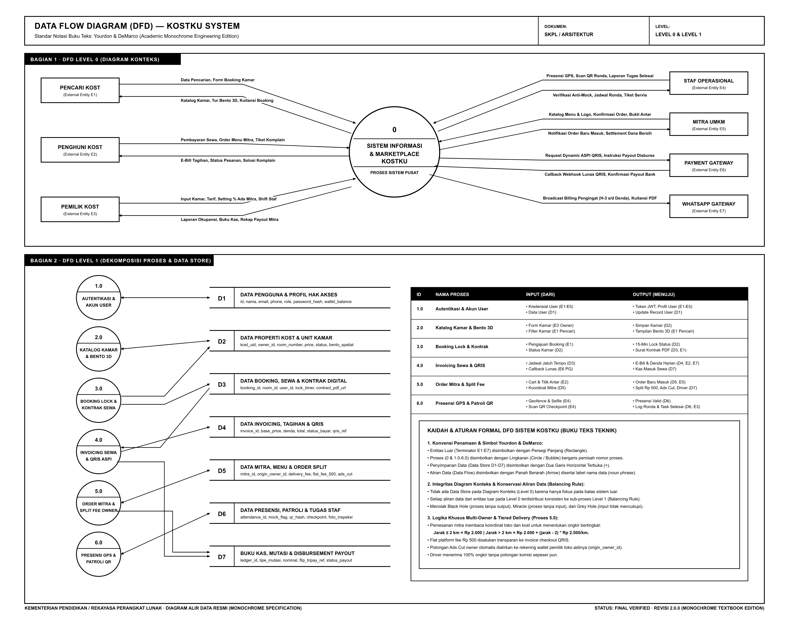
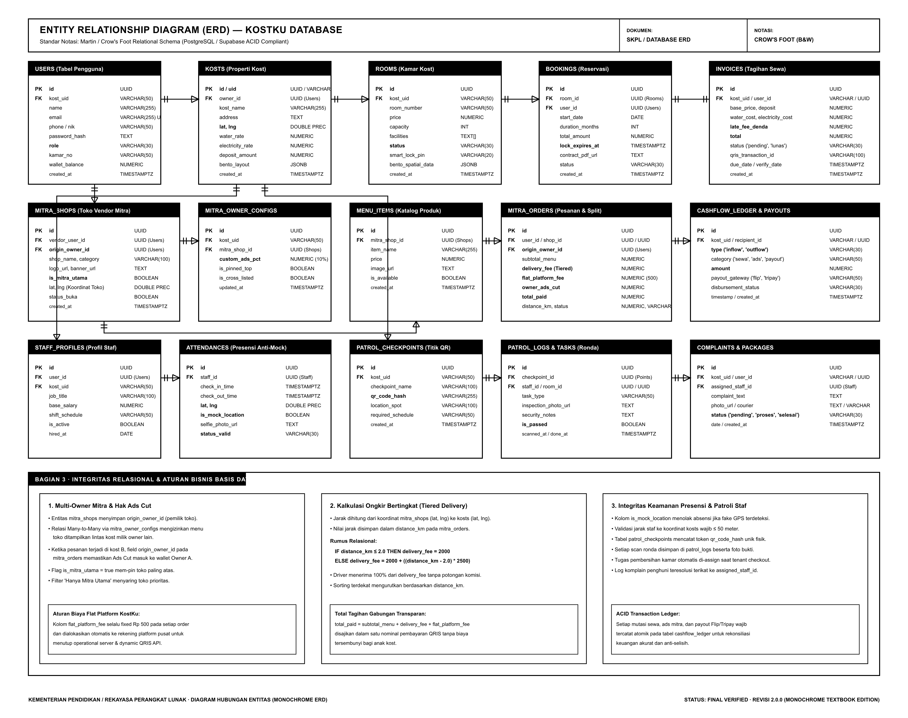

# 📑 Spesifikasi Resmi Data Flow Diagram (DFD) & Entity Relationship Diagram (ERD) KostKu

Dokumentasi teknis formal mengenai rancangan aliran data (**DFD Level 0 & Level 1**) serta struktur basis data relasional (**ERD**) untuk platform PropTech & Marketplace KostKu.

> [!NOTE]
> **Standar Rekayasa Perangkat Lunak (RPL / SKPL):**
> Sesuai dengan kaidah baku buku teks teknik informatika (Kendall & Kendall, Edward Yourdon, Tom DeMarco, IEEE), diagram DFD dan ERD ini dibuat dalam format **Monokrom Murni (Black & White Engineering Edition)** dengan latar belakang putih (`#FFFFFF`), garis batas hitam solid (`#000000`), dan tipografi presisi tanpa warna neon/gradasi, menjamin keterbacaan sempurna untuk cetak dokumen skripsi, audit sistem, maupun arsitektur teknis.

---

## 1. 🔄 Data Flow Diagram (DFD)

### Visual Diagram DFD (Monokrom)


* **File Vektor SVG (Monokrom):** [`docs/assets/diagrams/kostku_dfd.svg`](file:///home/rena/.gemini/antigravity/scratch/kostku/docs/assets/diagrams/kostku_dfd.svg)
* **File Gambar PNG:** [`docs/assets/diagrams/kostku_dfd.png`](file:///home/rena/.gemini/antigravity/scratch/kostku/docs/assets/diagrams/kostku_dfd.png)
* **Standar Notasi:** **Yourdon & DeMarco** (Circle Process / Bubble, Rectangle Terminator, Parallel Lines Data Store).

---

### Kaidah Baku Notasi Yourdon & DeMarco:
1. **Entitas Luar (External Entity / Terminator):** Disimbolkan dengan **Persegi Panjang Tajam (Sharp Rectangle)**. Mewakili pihak atau sistem eksternal di luar batas (*system boundary*) yang menjadi sumber (*source*) atau tujuan (*sink*) data.
2. **Proses (Process Bubble):** Disimbolkan dengan **Lingkaran (Circle)** yang dibagi garis pemisah horizontal: bagian atas berisi nomor identifikasi proses (`0`, `1.0`, dst.) dan bagian tengah/bawah berisi nama proses dengan format kata kerja aktif (*active verb + noun phrase*).
3. **Penyimpanan Data (Data Store):** Disimbolkan dengan **Dua Garis Horizontal Paralel Terbuka (`=`)** disertai kode penyimpanan (`D1` - `D7`) di sisi kiri.
4. **Aliran Data (Data Flow):** Disimbolkan dengan **Panah Berarah (Directed Arrow)** berlabel nama paket data (kata benda / *noun phrase*). Dilengkapi dengan lapisan pelindung (*halo mask*) agar garis tidak memotong atau menimpa teks label.

---

### A. DFD Level 0 (Diagram Konteks)
Diagram konteks memperlakukan seluruh sistem KostKu sebagai **satu proses tunggal hitam (Process 0)** yang menghubungkan 7 entitas luar:

> [!IMPORTANT]
> **Kaidah Ketat Level 0:** Pada Diagram Konteks, **TIDAK BOLEH ADA DATA STORE**. Data store hanya boleh dimunculkan saat proses didekomposisi pada Level 1.

| ID Entitas | Entitas Eksternal (Terminator) | Aliran Data Masuk (Inflow ke Sistem) | Aliran Data Keluar (Outflow dari Sistem) |
| :---: | :--- | :--- | :--- |
| **E1** | **Pencari Kost** | Data Pencarian, Form Booking Kamar, Pembayaran DP/Sewa | Katalog Kamar, Tur Bento 3D, Kuitansi Booking |
| **E2** | **Penghuni Kost (Tenant)** | Pembayaran Sewa, Order Menu Mitra, Tiket Komplain Kerusakan | E-Bill Tagihan, Status Pesanan Mitra, Solusi Komplain |
| **E3** | **Pemilik Kost (Owner)** | Input Kamar, Tarif, Setting % Ads Mitra, Jadwal Shift Staf | Laporan Okupansi, Buku Kas Laba Rugi, Rekap Payout Mitra |
| **E4** | **Staf Operasional** | Presensi GPS Koordinat, Scan QR Ronda, Laporan Tugas Selesai | Verifikasi Anti-Mock Location, Jadwal Ronda, Tiket Servis Kamar |
| **E5** | **Mitra UMKM (Vendor)** | Data Katalog Menu & Logo, Konfirmasi Order, Bukti Antar | Notifikasi Order Baru Masuk, Rekapitulasi Settlement Dana Bersih |
| **E6** | **Payment Gateway** | Callback Webhook Lunas QRIS, Konfirmasi Payout Bank | Request Dynamic ASPI QRIS, Instruksi Payout Disburse Flip/Tripay |
| **E7** | **WhatsApp Gateway** | Respon Baca / Interaksi Chat | Broadcast Billing Pengingat (H-3, H-1, Hari-H, Denda), Kuitansi PDF |

---

### B. DFD Level 1 (Dekomposisi Fungsional & 7 Data Store)

Pada Level 1, Proses 0 didekomposisi menjadi 6 sub-proses utama dengan 7 repositori data (*Data Store*):

```
[1.0 Autentikasi & Akun] <=====> D1: DATA PENGGUNA & PROFIL HAK AKSES
[2.0 Katalog & Bento 3D] <=====> D2: DATA PROPERTI KOST & UNIT KAMAR
[3.0 Booking Lock]       <-----> D3: DATA BOOKING, SEWA & KONTRAK DIGITAL (membaca D2)
[4.0 Invoicing & QRIS]   <-----> D4: DATA INVOICING, TAGIHAN & QRIS (membaca D3, mencatat D7)
[5.0 Order Mitra Split]  <-----> D5: DATA MITRA, MENU & ORDER SPLIT (mencatat D7)
[6.0 Presensi & Patroli] <-----> D6: DATA PRESENSI, PATROLI & TUGAS STAF
                                 D7: BUKU KAS, MUTASI & DISBURSEMENT PAYOUT
```

#### Aturan Keseimbangan Aliran Data (*Balancing Rule*):
- Seluruh input dan output yang dideklarasikan pada Level 0 dipetakan secara simetris ke sub-proses Level 1 tanpa ada kebocoran data (*data leakage*).
- Menghindari anomali DFD:
  - **No Black Hole:** Tidak ada proses yang hanya menerima input tanpa memproduksi output.
  - **No Miracle:** Tidak ada proses yang memproduksi output tanpa menerima input yang relevan.
  - **No Grey Hole:** Input yang diterima setiap proses mencukupi secara logika untuk menghasilkan output yang didefinisikan.

---

## 2. 🗄️ Entity Relationship Diagram (ERD)

### Visual Diagram ERD (Monokrom)


* **File Vektor SVG (Monokrom):** [`docs/assets/diagrams/kostku_erd.svg`](file:///home/rena/.gemini/antigravity/scratch/kostku/docs/assets/diagrams/kostku_erd.svg)
* **File Gambar PNG:** [`docs/assets/diagrams/kostku_erd.png`](file:///home/rena/.gemini/antigravity/scratch/kostku/docs/assets/diagrams/kostku_erd.png)
* **Standar Notasi:** **Martin / Crow's Foot Notation** (PostgreSQL / Supabase Relational Schema).

---

### Simbol & Notasi Kardinalitas Crow's Foot:
- `||` (**Mandatory One**): Tepat satu entitas wajib berelasi (misal: satu unit kamar wajib berada di tepat satu kost).
- `|<` (**Mandatory Many**): Minimal satu atau banyak entitas (misal: satu toko mitra memiliki minimal satu menu).
- `o|` (**Optional One**): Nol atau maksimal satu entitas (misal: staf assigned ke komplain).
- `o<` (**Optional Many**): Nol atau banyak entitas (misal: kamar memiliki nol atau banyak riwayat booking).

---

### 15 Tabel Basis Data & Relasi Relasional

#### Modul 1: Manajemen Properti & Sewa
1. `USERS`: Menyimpan identitas pemangku kepentingan (`owner`, `user/penghuni`, `staff`, `mitra`).
2. `KOSTS`: Properti kost fisik, alamat, koordinat `lat, lng`, tarif dasar air/listrik, dan denah bento.
3. `ROOMS`: Kamar kost, nomor kamar, harga, fasilitas, status (`kosong`, `terisi`, `kotor`), PIN smart lock.
4. `BOOKINGS`: Transaksi reservasi sewa, lock expires timer (15 menit anti tabrakan), durasi sewa, URL PDF kontrak digital.
5. `INVOICES`: Tagihan sewa bulanan, biaya utilitas, denda keterlambatan (`late_fee_denda`), status bayar, ID transaksi QRIS.

#### Modul 2: Ekosistem Mitra UMKM & Multi-Owner Ads Cut
6. `MITRA_SHOPS`: Profil toko/vendor, `origin_owner_id` (pemilik toko awal), koordinat `lat, lng`, flag `is_mitra_utama`.
7. `MITRA_OWNER_CONFIGS`: Tabel relasi multi-owner (*cross-listing*) yang mengatur persentase `custom_ads_pct` (default 10%), pin prioritas, dan visibilitas di kost lain.
8. `MENU_ITEMS`: Katalog produk makanan/minuman/jasa, harga, ketersediaan stok, URL foto produk.
9. `MITRA_ORDERS`: Transaksi pesanan makanan, ongkir bertingkat (`delivery_fee`), biaya platform flat (`flat_platform_fee = Rp 500`), potongan iklan (`owner_ads_cut`), total bayar.
10. `CASHFLOW_LEDGER`: Buku besar kas atomik, mencatat mutasi masuk (`inflow`), bagi hasil iklan (`ads_cut`), ongkir driver, dan pengeluaran transfer bank (`outflow`).

#### Modul 3: Operasional Staf & Keamanan Fisik
11. `STAFF_PROFILES`: Profil karyawan kost, `kost_uid`, jabatan (`penjaga`, `cleaning`, `security`), gaji pokok, shift kerja.
12. `ATTENDANCES`: Presensi anti-fraud, koordinat GPS geofence ($\le 50\text{ m}$), flag `is_mock_location` (deteksi fake GPS), foto selfie liveness.
13. `PATROL_CHECKPOINTS`: Titik-titik ronda fisik ber-barcode QR terenkripsi (`qr_code_hash`) di area vital (gerbang, toren air, ruang panel MCB).
14. `PATROL_LOGS`: Rekaman pemindaian patroli ronda, foto bukti inspeksi, catatan keamanan, dan verifikasi kelayakan.
15. `COMPLAINTS & PACKAGES`: Layanan tiket pengaduan kerusakan anak kost dan pencatatan titipan paket kurir, terikat ke `assigned_staff_id`.

---

## 3. ⚙️ Aturan Bisnis & Integritas Data Spesifik KostKu

### 1. Multi-Owner Mitra & Pembagian Dana Ads Cut
- Entitas `mitra_shops` mengikat `origin_owner_id` (Owner asal yang mendaftarkan toko mitra).
- Konfigurasi `mitra_owner_configs` memungkinkan kost milik owner lain menampilkan toko tersebut.
- Ketika penghuni di kost B membeli dari toko binaan Owner A, algoritma settlement secara otomatis mengalokasikan persentase `custom_ads_pct` langsung ke wallet Owner A.
- Toko dengan `is_mitra_utama = true` selalu diposisikan di baris teratas (*pinned top*) pada layar marketplace anak kost.

### 2. Skema Ongkir Bertingkat (*Tiered Delivery Fee*)
Kalkulasi ongkos kirim dihitung berdasarkan jarak Euclidean / Haversine antara toko mitra dan titik koordinat kost:
$$\text{Delivery Fee} = \begin{cases} \text{Rp } 2.000 & \text{jika } \text{jarak} \le 2.0\text{ km} \\ \text{Rp } 2.000 + ((\text{jarak} - 2.0) \times \text{Rp } 2.500) & \text{jika } \text{jarak} > 2.0\text{ km} \end{cases}$$
- **100% dari Delivery Fee** disalurkan utuh kepada staf kurir/driver tanpa potongan platform.
- **Flat Platform Fee Rp 500** ditambahkan secara transparan ke satu tagihan QRIS untuk membiayai operasional cloud server dan gateway API.

### 3. Integritas Keamanan Presensi & Patroli Fisik
- Absensi staf memvalidasi geofence radius $\le 50\text{ meter}$ dari titik gerbang kost.
- Pemeriksaan flag `is_mock_location`: jika terdeteksi aplikasi Fake GPS / Mock Location provider di perangkat staf, status presensi otomatis ditolak.
- Patroli ronda malam mewajibkan pemindaian hash fisik pada titik QR checkpoint disertai unggahan foto bukti kamera langsung tanpa perantara galeri.

---

> **Lokasi File Dokumentasi Internal:**
> - Spesifikasi Dokumen: [`docs/DFD_DAN_ERD_KOSTKU.md`](file:///home/rena/.gemini/antigravity/scratch/kostku/docs/DFD_DAN_ERD_KOSTKU.md)
> - DFD Vector SVG: [`docs/assets/diagrams/kostku_dfd.svg`](file:///home/rena/.gemini/antigravity/scratch/kostku/docs/assets/diagrams/kostku_dfd.svg)
> - ERD Vector SVG: [`docs/assets/diagrams/kostku_erd.svg`](file:///home/rena/.gemini/antigravity/scratch/kostku/docs/assets/diagrams/kostku_erd.svg)
> - DFD Render PNG: [`docs/assets/diagrams/kostku_dfd.png`](file:///home/rena/.gemini/antigravity/scratch/kostku/docs/assets/diagrams/kostku_dfd.png)
> - ERD Render PNG: [`docs/assets/diagrams/kostku_erd.png`](file:///home/rena/.gemini/antigravity/scratch/kostku/docs/assets/diagrams/kostku_erd.png)
