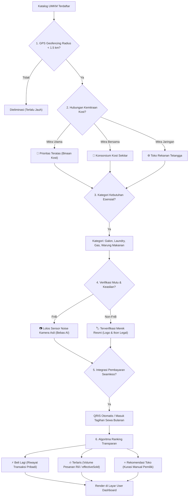
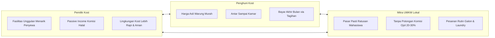

# Rasionalisasi & Algoritma Kurasi: Mengapa UMKM Tersebut yang Ditampilkan ke Customer (Penghuni Kost)

Dokumen ini menjelaskan secara komprehensif latar belakang filosofis, model bisnis, parameter teknis, dan algoritma penentuan UMKM yang ditampilkan pada layar **User Dashboard (Marketplace Mitra Sekitar Kost)** di platform **KostKu**.

---

## 1. Executive Summary & Filosofi Hyperlocal Survival Grid

Aplikasi *food delivery* dan *on-demand* raksasa (GoFood, GrabFood, ShopeeFood) dirancang untuk skala makro perkotaan dengan model bisnis *marketplace-wide*. Namun, model ini memiliki kelemahan fundamental bagi kehidupan anak kost:

* **Markup Ongkir & Platform Fee Mencekik**: Membeli segelas es teh Rp 5.000 atau air galon Rp 19.000 dikenakan ongkir Rp 10.000 - Rp 15.000 plus biaya jasa aplikasi, biaya penanganan, dan biaya kantong belanja sehingga total harga menjadi 2x lipat.
* **Driver Tertahan di Pagar Luar**: Driver ojol tidak memiliki akses masuk ke dalam area privat kost. Penghuni di lantai 2 atau 3 harus turun memakai pakaian rapi untuk mengambil pesanan di gerbang utama.
* **Waktu Tunggu Tidak Efisien**: Rata-rata *order-to-delivery time* mencapai 35 - 55 menit karena driver harus mencari lokasi resto, antre, dan berkendara dari jarak 3 - 7 km.
* **Tidak Melayani Kebutuhan Utilitas Esensial**: Ojol tidak memfasilitasi kebutuhan air galon angkat ke kamar, gas tabung dapur kost, atau cucian laundry kiloan harian.

> **Filosofi KostKu**: Menghadirkan **Hyperlocal Ring-1 Ecosystem (< 1.5 km)**. UMKM yang ditampilkan bukan sekadar "restoran acak", melainkan **life-support system terkurasi** yang terintegrasi langsung dengan operasional kost, diantar langsung sampai pintu kamar (*room delivery*), dengan biaya platform maksimal hanya Rp 500 dan bebas biaya tambahan fiktif.

---

## 2. Enam Pilar Penentu: Mengapa UMKM Tersebut yang Muncul di Layar Penghuni

Berikut adalah 6 parameter objektif yang menentukan apakah suatu UMKM berhak tampil di katalog penghuni kost:

---

### Pilar 1: Geofencing Hyperlocal & Kedekatan Fisik (Radius 0 - 1.5 km)

Penghuni kost membutuhkan kecepatan pemenuhan kebutuhan dasar (*instant survival gratification*). Algoritma menghitung koordinat GPS kost (`kost.location.lat`, `kost.location.lng`) terhadap lokasi UMKM:

1. **Walking Distance (< 500m)**: UMKM seperti Depot Air Barokah (150m) atau Warung Bu Siti (80m) mendapatkan prioritas tertinggi karena pesanan bisa diantar oleh staf kost atau kurir toko dalam hitungan 10–15 menit.
2. **Short Transit (< 1.5 km)**: Jaringan bersama multi-kost untuk layanan laundry kilat atau katering mahasiswa dengan waktu tempuh maksimal 7 menit.
3. **Eliminasi Toko Jauh (> 1.5 km)**: Toko yang berada di luar batas operasional hyperlocal otomatis difilter keluar untuk menjaga janji layanan pengantaran cepat dan menekan biaya logistik.

---

### Pilar 2: Hierarki Kemitraan Kost & Keberlanjutan Ekonomi Komunitas

KostKu menerapkan sistem kemitraan tiga tingkat (*three-tier partnership*) yang menguntungkan ekosistem lokal:

| Tipe Kemitraan | Badge | Kriteria & Alasan Ditampilkan | Bagi Hasil Komisi Owner |
| :--- | :--- | :--- | :--- |
| **Mitra Utama** | `👑 Utama` | **Binaan Eksklusif Pemilik Kost**: Toko/warung langganan resmi kost atau unit usaha sampingan pemilik kost. Menjadi default pilihan pertama di kartu karena staf kost mengenali pemilik toko secara personal. | Rp 500 - Rp 1.000 / transaksi (transparan) |
| **Mitra Bersama** | `🤝 Bersama` | **Konsorsium Multi-Kost**: UMKM yang melayani klaster beberapa kost berdekatan (misal Martabak & Roti Bakar Bangka 99). Memberikan variasi menu malam tanpa biaya operasional ganda. | Rp 500 / transaksi |
| **Mitra Jaringan** | `🌐 Jaringan` | **Afiliasi Kost Sekitar**: Mitra binaan dari kost rekanan tetangga (Kost B, Kost C) yang dimasukkan ke jaringan bersama untuk saling berbagi suplai saat stok toko utama sedang habis. | Rp 500 / transaksi |

---

### Pilar 3: Kebutuhan Utilitas Esensial Mahasiswa (FnB vs Non-FnB)

UMKM yang diseleksi wajib menjawab 4 pilar kebutuhan pokok harian penghuni:

1. **Air Galon (Hydration Utility)**:
   * Merek resmi: Aqua 19L (standar higienis), Vit 19L (opsi ekonomis hemat), Le Minerale (sekali pakai bebas BPA).
   * Nilai tambah: Diangkat langsung oleh kurir mitra sampai ke rak galon di dalam kamar penghuni.
2. **Laundry Kiloan (Hygiene Utility)**:
   * Melati Express & Dago Clean: Layanan cuci komplit kilat (1 hari) dan reguler (2 hari) per kg dengan harga mahasiswa.
   * Nilai tambah: Pakaian bersih diantar dalam kondisi terlipat rapi dan wangi.
3. **Gas LPG Melon 3kg (Cooking Utility)**:
   * Khusus kost dengan fasilitas dapur bersama atau kamar bertipe studio/VIP.
   * Tabung segel resmi SNI Pertamina diantar dengan standar keamanan pasang regulator.
4. **Warung Makan & Kuliner (Nutrition Utility)**:
   * Warung prasmanan Bu Siti, Katering Bento Sehat Bu Dian, dan Martabak Bangka.
   * Harga bersahabat mulai dari Rp 5.000 (Es Teh Manis Jumbo) hingga Rp 16.000 - Rp 21.000 (Nasi Ayam Bakar Komplit).

---

### Pilar 4: Metode Pembayaran Terintegrasi (Bebas Masalah Uang Pas)

Problem nomor 1 transaksi UMKM tradisional adalah **uang kembalian kurang** atau penghuni belum sempat menarik uang di ATM. UMKM yang ditampilkan wajib mendukung infrastruktur pembayaran non-tunai KostKu:

* **QRIS Real-Time Real Settlement**: Terintegrasi langsung dengan mutasi perbankan/e-wallet tanpa batas minimum pembelian.
* **Masuk Tagihan Sewa (Monthly Bill)**: Fasilitas *in-house paylater* di mana belanja galon, laundry, atau makan siang dicatat dan ditagihkan bersamaan dengan invoice sewa kamar di akhir bulan.
* **Sistem Poin Loyalitas & Referral**: Penghuni otomatis mendapatkan cashback 100 Poin untuk setiap pesanan yang dapat digunakan sebagai potongan diskon transaksi berikutnya.

---

### Pilar 5: Kurasi Kualitas & Anti-Slop (Sensor Kamera Asli vs Logo Resmi)

Agar penghuni tidak tertipu gambar fiktif atau editan internet, KostKu menerapkan kurasi visual berbasis jenis layanan:

* **Layanan Makanan (FnB)**:
  Wajib diverifikasi menggunakan **Sensor Defect & Noise Fingerprint Detector (PRNU)**.
  * Foto kamera asli dapur mitra mendapatkan badge `📷 Kamera Asli` (bebas rekayasa AI / stock photo internet).
  * Foto katalog internet yang gagal verifikasi ditandai peringatan `⚠️ Belum Asli` / `⚠️ Foto Web`.
* **Layanan Utilitas (Non-FnB / Galon, Laundry, Gas)**:
  Tidak memaksakan foto estetika makanan. Cukup menampilkan logo toko resmi, ikon utilitas (`💧`, `🧺`, `🔥`), dan label **`🏷️ Layanan Resmi`**.

---

### Pilar 6: Algoritma Ranking Transparan & Real Best Seller (Anti Ad-Bidding)

Platform raksasa menempatkan restoran di urutan teratas berdasarkan siapa yang membayar biaya iklan (*ad-bidding / sponsored listings*). KostKu menolak praktik ini dan menerapkan **3 lapis sorting murni meritokratis**:

#### A. Jalur Cepat "⚡ Beli Lagi" (Personalized Repeat Order)
Jika penghuni pernah memesan di toko tersebut (`hasOrderedBefore === true`):
* Toko tersebut diprioritaskan di tab **⚡ Beli Lagi**.
* Kartu toko dibersihkan dari badge yang tidak perlu (badge Best Seller, Non-FnB, dan Jaringan disembunyikan total).
* Tujuannya adalah memangkas waktu pemesanan (*quick-time click*) di bawah 10 detik.

#### B. Gelar Keabsahan "🔥 Terlaris (Xx Dipesan)"
* Penentuan posisi pertama menu bukan karena pemilik toko mencentang sendiri, melainkan dihitung secara matematis dari akumulasi volume pesanan riil (`effectiveSold = baseSold + dynamicSalesFromStorage`).
* Menu dengan angka pesanan terbanyak mendapatkan mahkota **`🔥 Terlaris (Xx Dipesan)`**.

#### C. Transparansi "⭐ Rekomendasi Toko"
* Jika pemilik toko menandai menu unggulan manual yang secara penjualan belum mencapai peringkat 1, sistem secara jujur melabelinya sebagai **`⭐ Rekomendasi Toko`**, **bukan** memalsukannya sebagai Best Seller.

---

## 3. Matriks Komparasi: KostKu vs Platform Ojol Konvensional

| Parameter Evaluasi | Platform Ojol Konvensional (Go/Grab/Shopee) | Ekosistem Mitra KostKu |
| :--- | :--- | :--- |
| **Jarak Suplai** | 2 km – 10 km (lintas kecamatan) | **0.05 km – 1.5 km (Ring-1 kost)** |
| **Biaya Tambahan** | Ongkir Rp 12.000 + Biaya Jasa Rp 3.000 + Biaya Kemasan | **Platform Fee Flat Maksimal Rp 500** |
| **Titik Pengantaran** | Pagar gerbang kost (penghuni harus turun) | **Pintu kamar penghuni (*room delivery*)** |
| **Layanan Utilitas** | Jarang ada (tidak ada pengantaran galon ke kamar) | **Air Galon, Tabung Gas, Laundry Kiloan** |
| **Metode Pembayaran** | E-wallet / Tunai (sering tidak ada kembalian) | **QRIS Real-Time + Masuk Tagihan Sewa Bulanan** |
| **Urutan Tampilan** | Siapa yang bayar slot iklan (*sponsored ads*) | **Data Riil Terlaris (*effectiveSold*) & Toko Langganan** |
| **Verifikasi Foto** | Rawan foto palsu dari internet/AI | **Sensor Noise PRNU Kamera Asli** |

---

## 4. Dampak Ekonomi Tripartit (Win-Win-Win Ecosystem)

1. **Bagi Penghuni (Customer)**:
   * Menghemat pengeluaran bulanan hingga Rp 300.000 - Rp 500.000 dari eliminasi biaya ongkir berulang.
   * Rasa aman karena kurir yang masuk ke area kost adalah orang yang dikenal pengelola kost.
2. **Bagi Mitra UMKM Sekitar**:
   * Memperoleh *captive market* tetap (puluhan hingga ratusan anak kost di satu gedung).
   * Tidak terbebani komisi mencekik 20% - 30% seperti di aplikasi food delivery konvensional.
3. **Bagi Pemilik Kost**:
   * Menjadi nilai jual unik (*unique selling point*) saat mempromosikan kamar kost ke calon penyewa.
   * Mendapatkan komisi pembinaan kemitraan yang legal, otomatis tercatat di laporan keuangan kost.

---

## 5. Pemetaan Kode Program Terkait

Rasionalisasi di atas diimplementasikan secara aktif dalam basis kode KostKu:

* **Penyaringan & Normalisasi Backend**: [backend/server.js](file:///home/rena/.gemini/antigravity/scratch/kostku/backend/server.js#L4442-L4495) (Route `/api/merchants` dengan filter koordinat `lat`, `lng`, dan hierarki kemitraan `isMainPartner`, `isShared`, `isNetwork`).
* **Katalog & Kartu Grid Frontend**: [src/pages/UserDashboard.jsx](file:///home/rena/.gemini/antigravity/scratch/kostku/src/pages/UserDashboard.jsx#L70-L115) (Komputasi `effectiveSold`, `isRealTopSeller`, `isStorePick`, dan cycle menu terlaris).
* **Badge Beli Lagi & Suppress Jaringan**: [src/pages/UserDashboard.jsx](file:///home/rena/.gemini/antigravity/scratch/kostku/src/pages/UserDashboard.jsx#L278-L415) (Penyederhanaan badge `⚡ Beli Lagi` tunggal dan penonaktifan badge jaringan).
* **Modal Pemesanan & Pencatatan Transaksi**: [src/components/PartnerOrderModal.jsx](file:///home/rena/.gemini/antigravity/scratch/kostku/src/components/PartnerOrderModal.jsx#L170-L200) (Penyajian menu terlaris berbasis data dan akumulasi counter penjualan).
