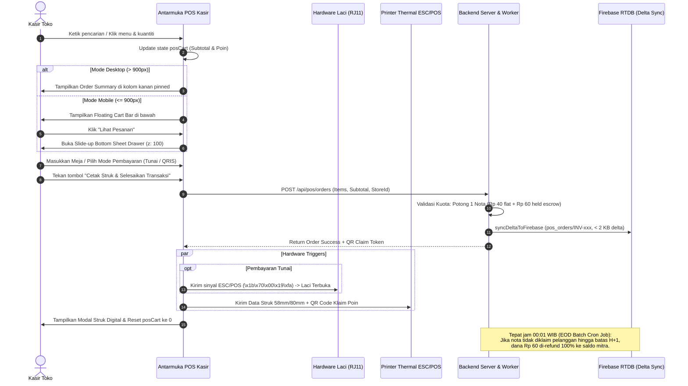

# BLUEPRINT & ARSITEKTUR LAYOUT KASIR POS KOSTKU (MOBILE & DESKTOP)

Dokumen spesifikasi komprehensif ini mendokumentasikan arsitektur antarmuka, tata letak visual (layout), hierarki komponen DOM, perilaku responsif, ergonomi sentuh, dan integrasi hardware dari sistem **Point of Sale (POS) Kasir KostKu** (`src/pages/Kasir.jsx`).

---

## 1. EXECUTIVE SUMMARY & FILOSOFI RANCANG BANGUN

Aplikasi Kasir POS KostKu dirancang untuk melayani ekosistem multi-mitra (kantin, kafe, laundry, dan warung makan di kawasan kost) dengan tuntutan operasional berkecapatan tinggi (*high-velocity checkout*).

### Pilar Utama Filosofi Desain:
1. **Single-Page Hybrid Ergonomics**: Tidak ada transisi perpindahan halaman yang memakan waktu (zero reload). Semua aksi pesanan, kalkulasi diskon, manajemen meja, antrean dapur (KDS), hingga pencetakan struk dan tendang laci uang terjadi secara reaktif dalam 1 tampilan.
2. **Dual-Form Factor Adaptation**:
   - **Desktop / Tablet Kasir Dedicated (> 900px)**: Menggunakan tata letak **2 Kolom Terpisah** (Katalog Menu 65% + Panel Keranjang Pinned 35%) agar kasir dapat melihat seluruh ringkasan pesanan, subtotal, dan metode pembayaran tanpa harus menutup katalog.
   - **Mobile Smartphone (<= 900px, 360px–430px)**: Menggunakan tata letak **1 Kolom Vertikal Ramping** dengan **Floating Cart Bar** mengambang di bawah dan **Slide-up Bottom Sheet Drawer (z-index: 100)** agar layar smartphone tetap lega untuk pencarian dan pengetukan menu tanpa terjadi tumpang tindih (*zero element collision*).
3. **Zero Clutter & Compact Density**: Seluruh header, toolbar aksi, dan pill kategori menggunakan densitas rapat (*compact density*) dengan padding mikro (4px–8px) agar tidak memakan ruang vertikal layar.
4. **Hardware-Ready First Class Citizen**: Terintegrasi langsung dengan printer kasir thermal (ESC/POS 58mm & 80mm via Web Bluetooth / Web Serial) dan pulsa laci uang (*Cash Drawer RJ11*) tanpa memerlukan software perantara tambahan (driverless browser execution).

---

## 2. BREAKPOINT & RESPONSIVE BEHAVIOR MATRIX

Sistem tata letak Kasir dikendalikan secara deklaratif melalui utility class CSS di `src/index.css` dan inline CSS token adaptif:

| Parameter Viewport | Mobile Smartphone (<= 900px) | Desktop & Tablet Kasir (> 900px) |
| :--- | :--- | :--- |
| **Target Perangkat** | Android/iOS Phone (360px – 430px) | Laptop Kasir, Monitor POS, iPad Pro, Android Tab |
| **Struktur Layout Grid** | 1 Kolom Full-Width (`grid-cols-1`) | 2 Kolom Berdampingan (`repeat(auto-fit, minmax(320px, 1fr))`) |
| **Panel Keranjang (Cart)** | Tersembunyi di balik *Floating Cart Bar* (bawah) & *Slide-Up Drawer* | Tampil persisten di kolom kanan (`position: sticky; top: 70px`) |
| **Display Helper CSS** | `.desktop-only { display: none !important; }` | `.desktop-only { display: block; }` |
| **Display Helper Flex** | `.desktop-only-flex { display: none !important; }` | `.desktop-only-flex { display: flex !important; }` |
| **Grid Katalog Menu** | 2 Kolom Kartu (`minmax(155px, 1fr)`) atau 1 Kolom List | 3–5 Kolom Kartu (`minmax(155px, 1fr)`) |
| **Pusat Aksi & Tools** | Tombol "Kelola" modal popup komprehensif | Baris toolbar horizontal + tombol kendali cepat navbar |
| **Bottom Navigation** | Mengambang di atas bottom bar dengan margin aman | Tidak mengganggu workspace desktop |

---

## 3. WIREFRAME & TATA LETAK DESKTOP (> 900PX)

Pada layar desktop dan tablet lebar (> 900px), antarmuka kasir memanfaatkan seluruh lebar horizontal layar dengan pembagian dua zona kerja utama:

```text
+------------------------------------------------------------------------------------------------------------------+
|  [<-] [LOGO] KostKu Cafe & Resto (Pusat) [✓ Valid]  |  [🪙 500 nota] [⚙️ Kelola] [🌓 Tema] [🔊 Sound] [🔄 Refresh] |
+------------------------------------------------------------------------------------------------------------------+
|  ⚠️ PERINGATAN KUOTA MENIPIS: Kuota nota Anda tersisa 12 transaksi...                           [ TOP UP SEKARANG ] |
+------------------------------------------------------------------------------------------------------------------+
|  [🏪 Multi-Cabang] [🏷️ Promo] [🎁 Redeem] [📦 Gudang 4!] [📊 Statistik] [🏆 Stamp] [🖨️ Laci & Print] [🔓 Buka Laci] |
+------------------------------------------------------------------------------------------------------------------+
|  [  🛍️ KASIR (POS)  ]    [  🔥 DAPUR (KDS - 3)  ]    [  🪑 MEJA & QR  ]    [  💰 KEUANGAN ESCROW  ]             |
+------------------------------------------------------------------------------------------------------------------+
|                                                      |                                                           |
|  [KOLOM KIRI: 65% LEBAR LAYAR - KATALOG & SEARCH]    |  [KOLOM KANAN: 35% LEBAR - ORDER SUMMARY PINNED (STICKY)] |
|                                                      |                                                           |
|  +------------------------------------------------+  |  +-----------------------------------------------------+  |
|  | [🔍 Cari menu makanan, minuman...] [田][目] [+] |  |  | 🛍️ Order Kasir Walk-in                   [ 3 Item ] |  |
|  +------------------------------------------------+  |  |-----------------------------------------------------|  |
|                                                      |  | [ Meja 04 (Indoor AC)               ] [ Ganti Meja ] |  |
|  [ Semua 12 ] [ 🍜 Makanan 6 ] [ 🥤 Minuman 4 ] ...  |  | [ Nama Pelanggan: Oscar (0812xxx)   ]               |  |
|                                                      |  |-----------------------------------------------------|  |
|  +---------------+  +---------------+  +-----------+ |  | DAFTAR ITEM PESANAN:                                |  |
|  | [ FOTO MENU ] |  | [ FOTO MENU ] |  | ...       | |  | 1. Mie Gacoan Lv 2             x2   Rp 26.000 [-][+]|  |
|  | Mie Gacoan    |  | Nasi Goreng   |  |           | |  |    * Catatan: Ekstra Pangsit Pedas                 |  |
|  | Lv 2          |  | Spesial       |  |           | |  | 2. Es Teh Manis Jumbo          x1   Rp  5.000 [-][+]|  |
|  | Rp 13.000     |  | Rp 18.000     |  |           | |  |-----------------------------------------------------|  |
|  | [-] 2 [+]     |  | [-] 1 [+]     |  |           | |  | Subtotal:                                 Rp 31.000 |  |
|  | [+ Tambah]    |  | [+ Tambah]    |  |           | |  | Voucher Promo: [ HEMAT10 - Rp 3.100 ]            v |  |
|  +---------------+  +---------------+  +-----------+ |  | Potongan Poin: [- 100 Poin = -Rp 100]        [ Pakai]|  |
|                                                      |  | Biaya Platform Kasir:                          Rp 40 |  |
|  +---------------+  +---------------+  +-----------+ |  | Held Promo Escrow (Refundable):                Rp 60 |  |
|  | [ FOTO MENU ] |  | [ FOTO MENU ] |  | ...       | |  | Total Tagihan:                            Rp 27.900 |  |
|  | Es Teh Jumbo  |  | Dimsum Ayam   |  |           | |  |-----------------------------------------------------|  |
|  | Rp 5.000      |  | Rp 15.000     |  |           | |  | [💵 Tunai (Laci)]  [💳 QRIS Dinamis]  [📱 Transfer]   |  |
|  | [-] 1 [+]     |  | [-] 0 [+]     |  |           | |  | Nominal Bayar: [ Rp 50.000                        ] |  |
|  | [+ Tambah]    |  | [+ Tambah]    |  |           | |  | Kembalian:                              Rp 22.100 |  |
|  +---------------+  +---------------+  +-----------+ |  |-----------------------------------------------------|  |
|                                                      |  | [🔓 BUKA LACI]       [🖨️ CETAK STRUK & SELESAIKAN]   |  |
|                                                      |  +-----------------------------------------------------+  |
+------------------------------------------------------------------------------------------------------------------+
```

---

## 4. WIREFRAME & TATA LETAK MOBILE (<= 900PX)

Pada layar smartphone (360px – 430px), seluruh elemen visual disusun secara vertikal (*single flow*). Panel keranjang dipindahkan ke dalam **Slide-Up Bottom Sheet Drawer** yang hanya muncul saat tombol **Floating Cart Bar** diketuk.

```text
+-----------------------------------------+
| [<-] [K] Cafe & Resto [✓]   [🪙 500] [⚙️]|
+-----------------------------------------+
| ⚠️ Sisa Kuota: 12 Transaksi   [ Top Up ]|
+-----------------------------------------+
| [🏷️Promo] [🎁Redeem] [📦Gudang 4!] [📊] >>|  <- Horizontal Smooth Scroll
+-----------------------------------------+
| [ 🛍️ Kasir ] [ 🔥 Dapur ] [ 🪑 Meja ] [ 💰]|  <- 4-Segment Modern Tabs
+-----------------------------------------+
| [🔍 Cari menu makanan, minuman...] [田][+] |
+-----------------------------------------+
| ( Semua 12 ) ( 🍜 Makanan 6 ) ( 🥤 Minum 4)|  <- Horizontal Filter Pills
+-----------------------------------------+
|                                         |
| +-----------------+ +-----------------+ |
| | [ FOTO MENU ]   | | [ FOTO MENU ]   | |
| | Mie Gacoan Lv 2 | | Nasi Goreng     | |
| | Rp 13.000       | | Rp 18.000       | |
| | [ - ] 2 [ + ]   | | [ - ] 1 [ + ]   | |
| | [ + Tambah ]    | | [ + Tambah ]    | |
| +-----------------+ +-----------------+ |
|                                         |
| +-----------------+ +-----------------+ |
| | [ FOTO MENU ]   | | [ FOTO MENU ]   | |
| | Es Teh Jumbo    | | Dimsum Ayam     | |
| | Rp 5.000        | | Rp 15.000       | |
| | [ - ] 1 [ + ]   | | [ - ] 0 [ + ]   | |
| | [ + Tambah ]    | | [ + Tambah ]    | |
| +-----------------+ +-----------------+ |
|                                         |
|                                         |
+-----------------------------------------+
| 🛍️ [ 3 ]  Meja 04 • Rp 27.900  [Lihat >]|  <- FLOATING CART BAR (z-45)
+-----------------------------------------+
```

### Transisi Slide-up Bottom Sheet Drawer saat "Lihat Pesanan" Diklik:
Ketika kasir menekan tombol "Lihat Pesanan", sistem mengubah state `showMobileCartDrawer` menjadi `true`:
```text
+=========================================+
|             [ OVERLAY GELAP (z: 100) ]  |
|                                         |
|  +-----------------------------------+  |
|  | (---) Swipe Bar Handle            |  |
|  | 🛍️ Pesanan Kasir (3 Item)      [X] |  |
|  |-----------------------------------|  |
|  | 1. Mie Gacoan Lv 2  x2  Rp 26.000 |  |
|  | 2. Es Teh Jumbo     x1  Rp  5.000 |  |
|  |-----------------------------------|  |
|  | Diskon Promo: -Rp 3.100           |  |
|  | Total: Rp 27.900                  |  |
|  |-----------------------------------|  |
|  | [💵 Tunai]  [💳 QRIS]  [📱 Bank]  |  |
|  | Bayar: [ Rp 50.000              ] |  |
|  | Kembalian: Rp 22.100              |  |
|  |-----------------------------------|  |
|  | [🔓 Buka Laci]                    |  |
|  | [  🖨️ BAYAR & CETAK STRUK       ] |  |
|  +-----------------------------------+  |
+=========================================+
```
State `showMobileCartDrawer` ditutup (`false`) saat tombol `[X]`, tombol bayar selesai, atau area luar backdrop disentuh.

---

## 5. BEDAH HIERARKI KOMPONEN LAYER-BY-LAYER

Kode antarmuka kasir disusun dalam 7 layer DOM yang terstruktur secara semantik:

### Layer 1: Compact Sticky Top Navbar (`<header>`, z-index: 40)
- **Kiri**:
  - Tombol kembali `[<-]` ke dashboard KostKu (`/dashboard`).
  - Logo toko (`/logo.png`, 28x28px).
  - Nama toko mitra yang aktif (`storeInfo.storeName`) dengan badge verifikasi hijau `[✓]`.
  - Sub-deskripsi lokasi dan nama kasir yang bertugas.
- **Kanan**:
  - Chip Kuota Saldo Nota (`[🪙 500 nota]`). Berwarna kuning jika aman, berubah merah dan berkedip saat $\le 15$ nota.
  - Tombol **"Kelola"** (`setShowToolsDrawer(true)`) dilengkapi notifikasi titik merah jika ada stok bahan baku yang menipis.
  - Kendali Desktop-Only: Toggle Tema Terang/Gelap (`toggleTheme`), Toggle Sound FX Transaksi (`audioAlert`), dan Tombol Refresh Data (`fetchData`).

### Layer 2: Realtime Alert & Threshold Banner
- **Banner Peringatan Kuota Nota Menipis**:
  - Muncul otomatis jika sisa kuota nota $\le 15$ transaksi.
  - Berwarna kuning lembut (`#fffbeb`) pada sisa 6–15 nota, dan merah tegas (`#fef2f2`) pada sisa $\le 5$ nota dengan tombol aksi langsung `[Top Up]`.
- **Banner Peringatan Bahan Baku Gudang Menipis**:
  - Muncul jika `inventoryAlerts.length > 0`.
  - Berisi ringkasan 3 bahan teratas yang menipis beserta tombol aksi `[Restock]`.

### Layer 3: 1-Baris Quick Action Tools Toolbar (`overflow-x: auto`)
Toolbar horizontal satu baris yang dapat digeser secara halus (*touch scroll*):
1. **Multi-Store Dropdown**: Pemilih cabang toko aktif jika pemilik memiliki lebih dari 1 outlet.
2. **Promo (`<Tag />`)**: Membuka popup manajemen diskon persentase dan potongan nominal.
3. **Redeem (`<Gift />`)**: Membuka klaim kode voucher kasir khusus.
4. **Gudang (`<Package />`)**: Pemantauan inventaris bahan baku dan resep (HPP).
5. **Statistik (`<BarChart3 />`)**: Laporan omset kotor, margin laba bersih, dan item terlaris.
6. **Stamp & Poin (`<Award />`)**: Monitor kartu loyalitas digital pelanggan.
7. **Laci & Print (`<Printer />`)**: Modal konfigurasi printer thermal Bluetooth/USB dan uji coba kick pulse laci kasir.
8. **Buka Laci (`🔓`)**: Tombol pintas darurat untuk membuka laci kasir secara langsung tanpa transaksi.
9. **Karyawan (`<Users />`)**: Link cepat ke manajemen shift kasir dan staf.
10. **Lokasi Toko (`<MapPin />`)**: Pengaturan koordinat geolokasi toko.

### Layer 4: Segmented 4-Tab Bar
Sistem tab 4-segmen modern menggunakan pill biru aktif (`#2563eb`):
- **Kasir (POS)**: Katalog produk, pencarian, dan panel pembayaran walk-in.
- **Dapur (KDS)**: Kanban antrean pesanan masak (*Kitchen Display System*) dengan indikator badge pesanan belum di-ACC.
- **Meja & QR**: Peta denah meja, status okupansi (Kosong vs Terisi), serta cetak QR Code meja.
- **Keuangan**: Rekonsiliasi mutasi kasir harian, status escrow dana promo Rp 60 yang tertahan, dan penarikan saldo.

### Layer 5: Area Kerja Utama (Main Workspace - Tab POS)
- **Zona Pencarian & Filter**:
  - Kolom pencarian realtime dengan tombol reset silang `[X]`.
  - Tombol pemilih tampilan: **Grid View (`<LayoutGrid />`)** vs **List View (`<List />`)**.
  - Tombol **+ Menu Baru** untuk pendaftaran instan menu baru.
  - Baris pill kategori (`Semua`, `Makanan`, `Minuman`, `Snack`, dll.) dengan jumlah item aktif.
- **Grid Kartu Produk (`repeat(auto-fill, minmax(155px, 1fr))`):**
  - Gambar produk rasio 16:9 dengan *lazy loading* dan fallback gambar.
  - Tombol pintas **Edit Menu** di pojok kiri atas foto.
  - Badge penanda varian/topping jika produk memiliki pilihan rasa/level pedas.
  - Nama produk, harga jual bertipe mata uang tebal, dan sisa porsi.
  - **Direct Quantity Selector**: Tombol `[-]`, input angka kuantiti langsung, dan `[+]` sebelum menekan tombol "Tambah ke Keranjang".
- **Desktop Cart Panel (`.desktop-only`, z-index normal, sticky top 70px):**
  - Pemilih nomor meja atau mode Walk-in Takeaway.
  - Daftar belanjaan dengan penyesuaian catatan koki (*custom notes per item*).
  - Kalkulator diskon kupon promo & penukaran poin loyalitas pelanggan.
  - Rincian transparansi biaya: Subtotal, Diskon, Biaya Admin Rp 40, Deposit Promo Rp 60 (Refundable), dan Total Tagihan Bersih.
  - Tiga metode pembayaran: **Tunai (Cash Drawer)**, **QRIS Dinamis**, dan **Transfer Bank**.
  - Kalkulator kembalian instan dengan pecahan uang cepat (`Pas`, `Rp 20.000`, `Rp 50.000`, `Rp 100.000`).

### Layer 6: Mobile Floating Cart Bar & Slide-Up Drawer
- **Floating Cart Bar (z-index: 45)**:
  - Tampil di bagian bawah layar (`bottom: 16px; left: 12px; right: 12px; max-width: 560px`).
  - Latar belakang gradasi gelap modern (`#1e293b` ke `#0f172a`) dengan efek *backdrop-filter blur(12px)*.
  - Menampilkan total item pesanan, nomor meja/mode walk-in, total nominal harga, dan tombol hijau `[Lihat Pesanan >]`.
- **Slide-Up Bottom Sheet Drawer (z-index: 100)**:
  - Menutupi layar dengan backdrop semi-transparan hitam (`rgba(0,0,0,0.65)`).
  - Kontainer putih melengkung di bagian atas (`borderTopLeftRadius: 22px; borderTopRightRadius: 22px`).
  - Maksimal tinggi 85vh dengan *overflow-y auto* untuk mencegah terpotongnya tombol bayar pada layar HP kecil.
  - Memuat seluruh fungsionalitas checkout desktop secara utuh (*100% feature parity*).

### Layer 7: Modal Ekosistem Kasir (z-index: 50 – 110)
- **Modal Add/Edit Menu**: Upload foto, setel nama, kategori, harga modal (HPP), harga jual, resep bahan baku, dan varian.
- **Modal Hardware & Laci Kasir**: Scanning printer Bluetooth/Serial, pengaturan lebar kertas (58mm/80mm), opsi auto-cut, dan auto-kick drawer.
- **Modal Preview Struk Thermal**: Format struk autentik monospaced lengkap dengan QR Code klaim poin loyalitas pelanggan.
- **Modal Topup Saldo Nota**: Pilihan paket nota (50 nota, 200 nota, 500 nota, 1.000 nota) dengan simulasi QRIS instan.

---

## 6. INTEGRASI HARDWARE: LACI KASIR (RJ11) & PRINTER THERMAL

Sistem Kasir KostKu dilengkapi modul driver mandiri di browser (`src/utils/thermalPrinter.js` dan `src/pages/Kasir.jsx`) untuk mengontrol laci uang fisik (*cash drawer*).

### Arsitektur Alur Tendang Laci (Cash Drawer Kick):
1. **Laci RJ11 via Printer Thermal (Standar Industri Terpopuler)**:
   - Kabel RJ11 laci dicolokkan ke port *DK (Drawer Kick)* di belakang printer thermal.
   - Browser mengirimkan pulsa sinyal standar ESC/POS:
     ```text
     Hex Command: \x1b\x70\x00\x19\xfa
     Penjelasan:
       \x1b\x70 = Perintah ESC p (Generate Pulse)
       \x00     = Pin 2 RJ11 (Konektor Laci Utama)
       \x19     = Waktu ON pulsa: 25 * 2ms = 50ms (tegangan elektromagnet aktif)
       \xfa     = Waktu OFF pulsa: 250 * 2ms = 500ms (jeda sebelum pulsa berikutnya)
     ```
2. **Koneksi Web Bluetooth & Web Serial**:
   - Web Bluetooth API (`navigator.bluetooth.requestDevice`) untuk printer portable Bluetooth 58mm.
   - Web Serial API (`navigator.serial.requestPort`) untuk printer USB/Kabel POS desktop 80mm.
3. **Pemicu Otomatis vs Manual**:
   - **Otomatis**: Laci terbuka saat kasir menekan tombol "Bayar Tunai & Selesaikan Transaksi".
   - **Manual**: Kasir dapat menekan tombol `[🔓 Buka Laci]` di toolbar atau di samping tombol pembayaran tanpa membuat transaksi baru (misal saat ingin menukar uang pecahan kecil).

---

## 7. SISTEM WARNA, ELEVASI, & Z-INDEX TOKENS

Untuk menjaga konsistensi visual dan mencegah tumpang tindih elemen (*anti-slop & zero element overlap*), sistem menggunakan skala elevasi dan token desain ketat:

### A. Token Warna Fungsional
| Token | Nilai Hex | Penggunaan di Kasir |
| :--- | :--- | :--- |
| **Brand Primary** | `#2563eb` (Blue 600) | Tab aktif, tombol tambah menu, border item terpilih |
| **Success Action** | `#10b981` (Emerald 500) | Tombol checkout pembayaran, status toko valid `[✓]` |
| **Warning Escrow** | `#f59e0b` (Amber 500) | Status pending KDS, chip kuota nota, peringatan stok |
| **Danger Alert** | `#ef4444` (Red 500) | Stok habis, kuota nota menipis kritis, tombol hapus item |
| **Dark Slate Bar** | `#1e293b` – `#0f172a` | Floating Cart bar mobile, header modal |

### B. Hierarki Z-Index (Anti-Overlap Matrix)
```text
z-index: 110  -->  Toast Notifications & Floating SweetAlert
z-index: 100  -->  Mobile Slide-Up Bottom Sheet Checkout Drawer & Fullscreen Modals
z-index:  50  -->  Quick Action Modals (Topup Nota, Restock Gudang, Edit Menu)
z-index:  45  -->  Mobile Floating Cart Bar (tetap di atas katalog menu)
z-index:  40  -->  Sticky Top Navbar Header & Location Alert
z-index:   1  -->  Konten Katalog Menu, Tombol Varian, Filter Pills
```

---

## 8. ERGONOMI MOBILE THUMB-ZONE & AKSESIBILITAS WCAG

Antarmuka mobile dirancang berdasarkan zona jangkauan ibu jari (*Mobile Thumb-Zone Ergonomics*):

```text
+-----------------------------------------+
| [ Zona Sukar Dijangkau ]                | -> Hanya untuk logo, nama toko, & info status
|                                         |
+-----------------------------------------+
| [ Zona Sedang (Perlu Peregangan) ]     | -> Kolom pencarian & filter kategori
|                                         |
+-----------------------------------------+
|                                         |
| [ ZONA NATURAL IBU JARI ]               | -> Kartu produk, pengetukan tombol tambah menu,
|                                         |    dan penyesuaian kuantiti (+ / -)
|                                         |
+-----------------------------------------+
| [ ZONA PRIORITAS UTAMA (AKSI CEPAT) ]   | -> FLOATING CART BAR & TOMBOL CHECKOUT
+-----------------------------------------+
```

### Standar Aksesibilitas:
1. **Target Sentuh Minimum 44x44px**: Seluruh tombol increment kuantiti, tombol silang modal, dan trigger drawer memenuhi rasio minimum sentuhan jari manusia tanpa salah ketuk.
2. **Kontras Teks WCAG AA (Min 4.5:1)**: Nilai harga dan subtotal menggunakan teks kontras tinggi (putih pada gelap, atau teks slate 900 pada latar putih).
3. **Format Angka Monospaced**: Seluruh kalkulasi harga menggunakan font angka monospaced (`fontFamily: 'var(--font-mono)'`) sehingga digit angka sejajar rapi saat dijumlahkan.

---

## 9. DIAGRAM ALUR INTERAKSI TRANSAKSI POS (MERMAID)

Berikut adalah diagram sekuens interaksi lengkap dari penambahan item hingga pencetakan struk dan EOD escrow settlement:



---

## 10. KESIMPULAN

Rancangan layout Kasir POS KostKu berhasil memadukan performa tinggi, ergonomi sentuh, dan kepraktisan operasional:
- **Di Desktop**, kasir mendapatkan efisiensi maksimal dengan tata letak split 2-kolom tanpa distraksi modal.
- **Di Mobile**, kasir mendapatkan kenyamanan pengoperasian satu tangan dengan *single vertical catalog*, *floating cart*, dan *bottom sheet drawer* yang rapi bebas tumpang tindih.
- **Di Sisi Hardware**, integrasi laci uang RJ11 dan printer thermal beroperasi otomatis langsung dari peramban web modern tanpa instalasi driver pihak ketiga.
