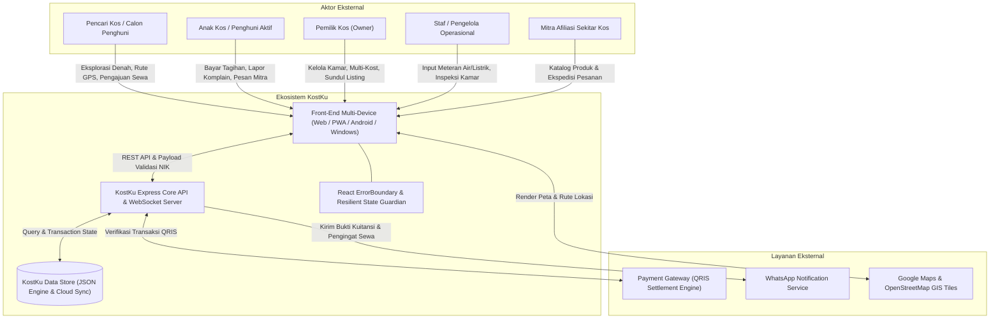
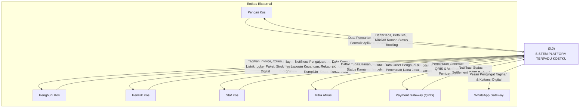
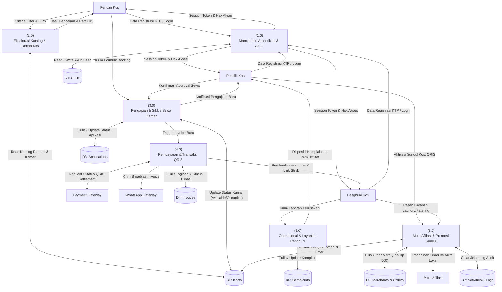
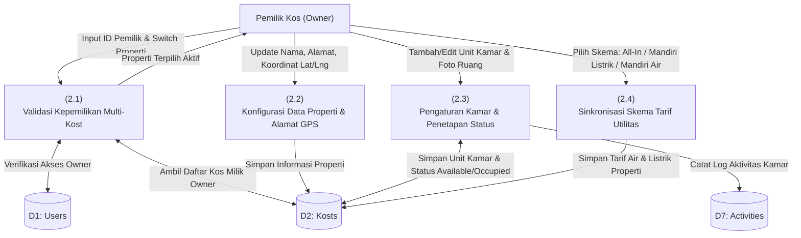
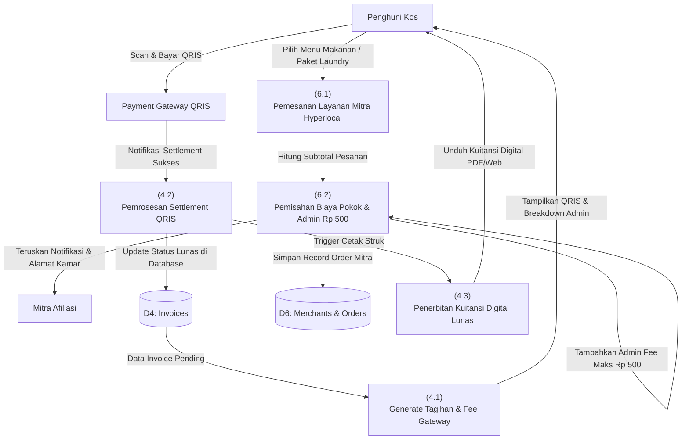
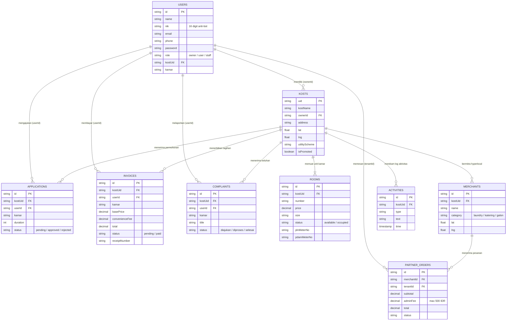
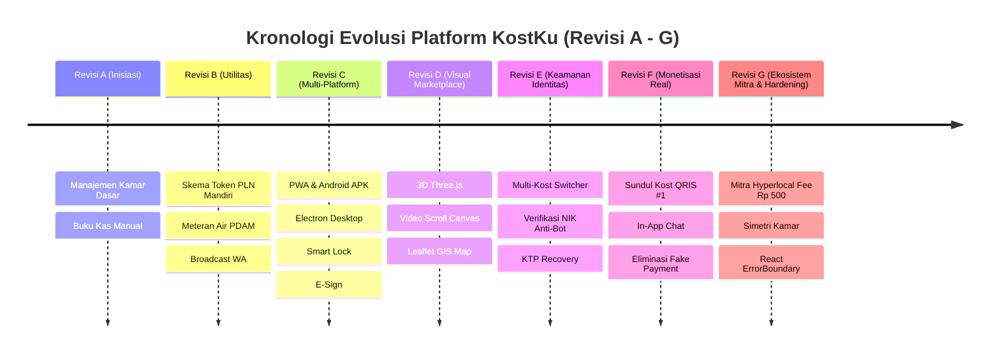

SKPL
SPESIFIKASI KEBUTUHAN PERANGKAT LUNAK
KostKu (Smart Boarding & Hyperlocal Co-Living Ecosystem)
untuk: 
Pemilik Kos & Pencari Kos Indonesia
Dipersiapkan oleh:
Kelompok RPL - S1 Teknik Informatika UDINUS:
1. Oscar Herdian Wijaya (NIM: A11.2025.16309)
2. Yohanes Aryo Suryo Rahardjo (NIM: A11.2025.16479)
3. M. Mirza Fadilah (NIM: A11.2025.16354)
Program Studi Teknik Informatika
FIK - UDINUS
Jl. Imam Bonjol no. 207, Semarang

|  | Program Studi Teknik Informatika FIK – UDINUS | Nomor Dokumen: SKPL-UDINUS-KOSTKU-2026 | Halaman: 1 dari 48 |
|---|---|---|---|
| | | SKPL-KOSTKU-V2 | Rev G |
| | | Revisi: G | Tgl: 16 Oktober 2026 |

DAFTAR PERUBAHAN
| Revisi | Deskripsi |
| A | Inisiasi KostKu V1.0 (Manajemen kamar, sewa, data anak kost dasar, dan pembukuan kas manual) |
| B | Integrasi Utilitas & Tagihan (Kwh token listrik PLN prabayar, meteran air PDAM, skema utilitas 3-jalur, dan broadcast WhatsApp) |
| C | PWA, Multi-Platform & Smart Operations (PWA Service Worker, Capacitor Android APK, Electron Desktop, Smart Lock, Inspeksi Kamar, E-Signature kontrak) |
| D | Modernisasi Marketplace Visual (3D WebGL Three.js, Video Scroll Scrubbing Canvas, Spatial Bento Showcase, Filter Peta Interaktif Leaflet GPS) |
| E | Multi-Kost & Keamanan Akun (Property switcher multi-properti owner, verifikasi 1 KTP 1 Akun NIK 16-digit anti-bot, dan pemulihan akun via NIK) |
| F | Monetisasi Real & Sundul Kost (Sundul Kost promoted listing slot #1 via QRIS merchant, live countdown, In-App Chat konsultasi, eliminasi simulasi pembayaran fiktif) |
| G | Ekosistem Mitra Afiliasi & Hardening Zero-Error (Mitra UMKM laundry/katering sekitar kost dengan batas komisi Rp 500, simetri siklus kamar terisi/tersedia, React ErrorBoundary, dan pengujian otomatis 14 rute) |

| INDEX TGL | - | A | B | C | D | E | F | G |
| Ditulis oleh | Tim Pengembang | 01/08/26 | 15/08/26 | 01/09/26 | 15/09/26 | 01/10/26 | 10/10/26 | 16/10/26 |
| Diperiksa oleh | Quality Assurance / Lead Architect | 03/08/26 | 17/08/26 | 03/09/26 | 17/09/26 | 03/10/26 | 12/10/26 | 16/10/26 |
| Disetujui oleh | Dosen Pembimbing / Stakeholder | 05/08/26 | 20/08/26 | 05/09/26 | 20/09/26 | 05/10/26 | 14/10/26 | 16/10/26 |

Daftar Isi
1. Pendahuluan	4
1.1	Tujuan Penulisan Dokumen	4
1.2	Lingkup Masalah	4
1.3	Definisi, Istilah  dan Singkatan	4
1.4	Aturan Penomoran	5
1.5	Referensi	5
1.6	Deskripsi umum Dokumen (Ikhtisar)	5
2	Deskripsi Umum Perangkat Lunak	6
2.1	Deskripsi Umum Sistem	6
2.2	Karakteristik Pengguna	7
2.3	Batasan	7
2.4	Lingkungan Operasi	8
3	Deskripsi Kebutuhan	9
3.1	Kebutuhan Antarmuka Eksternal	9
3.1.1	Antarmuka pemakai	9
3.1.2	Antarmuka Perangkat Keras	9
3.1.3	Antarmuka Perangkat Lunak	9
3.1.4	Antarmuka Komunikasi	10
3.2	Kebutuhan Fungsional	10
3.2.1	Diagram Konteks	13
3.2.2	DFD Level 1	14
3.2.2.1	DFD Level 2 (Manajemen Kamar & Properti)	15
3.2.2.2	DFD Level 2 (Transaksi Sewa, Pembayaran & Mitra Afiliasi)	16
3.2.3	Data Store	17
3.3	Kebutuhan Data	18
3.3.1	E-R diagram	19
3.4	Kebutuhan Non Fungsional	20
3.5	Batasan Perancangan	22
3.6	Kerunutan (traceability)	23
3.6.1	Kebutuhan Fungsional vs Proses	23
3.6.2	Data Store vs E-R	24
3.7	Ringkasan Kebutuhan	25
3.7.1	Kebutuhan Fungsional	25
3.7.2	Kebutuhan Non Fungsional	26
4	Matriks Evolusi & Riwayat Perubahan Fitur (Ditambah, Diubah, Dihapus)	27
4.1	Fitur yang Ditambahkan (Added Features)	27
4.2	Fitur yang Diubah / Dimodifikasi (Modified Features)	30
4.3	Fitur yang Dihapus / Dieliminasi (Removed Features)	32

---

# 1. Pendahuluan

## 1.1 Tujuan Penulisan Dokumen
Dokumen Spesifikasi Kebutuhan Perangkat Lunak (SKPL) ini disusun sebagai dokumen acuan formal dan pedoman rekayasa perangkat lunak dalam perancangan, pengembangan, pengujian (*quality assurance*), serta penggelaran (*deployment*) platform **KostKu (Smart Boarding & Hyperlocal Co-Living Ecosystem)**. 

Dokumen ini ditujukan untuk digunakan oleh:
1. **Tim Pengembang (*Software Engineering Team*)**: Sebagai spesifikasi implementasi kode, skema basis data, arsitektur API, dan komponen antarmuka.
2. **Dosen Pembimbing & Penguji Akademik Program Studi Teknik Informatika FIK - UDINUS**: Sebagai dasar evaluasi pemenuhan standar rekayasa perangkat lunak, metodologi pemodelan fungsional (DFD & ERD), serta ketertelusuran kebutuhan (*traceability*).
3. **Pemilik Kost (*Owners*) & Mitra Komersial**: Sebagai pemahaman kontrak fungsionalitas sistem back-office manajemen sewa, tata kelola utilitas, promosi Sundul Kost, serta pembagian komisi transaksi mikro mitra.
4. **Pencari dan Penghuni Kost (*Tenants*)**: Sebagai kepastian transparansi informasi denah kamar 2D/3D riil, rincian pembayaran tagihan non-COD QRIS real, dan layanan pesanan mitra lokal sekitar hunian.

## 1.2 Lingkup Masalah
**KostKu** adalah platform ekosistem digital dua sisi (*two-sided marketplace & back-office SaaS*) yang mengintegrasikan pencarian indekos berbasis denah arsitektur akurat, peta geospasial Leaflet real-time, dan estimasi beban utilitas mandiri bagi pencari kost, dengan sistem otomatisasi manajemen operasional harian bagi pemilik kost (pencatatan sewa, penerbitan invoice otomatis, inspeksi kamar, smart lock token, pemantauan kWh listrik/air PDAM, broadcast WhatsApp, pendaftaran multi-properti, serta promosi berbayar Sundul Kost ber-QRIS). Platform ini juga memadukan jaringan mitra afiliasi UMKM hyperlocal di sekitar lokasi indekos (seperti penyedia jasa laundry, katering harian, dan air mineral galon) dengan tarif komisi mikro yang adil dan transparan (maksimal Rp 500 per transaksi) guna menciptakan ekosistem hunian modern yang terjangkau, efisien, dan bebas manipulasi.

## 1.3 Definisi, Istilah dan Singkatan
* **SKPL**: Spesifikasi Kebutuhan Perangkat Lunak (padanan *Software Requirements Specification* / SRS).
* **KostKu**: Nama resmi sistem perangkat lunak marketplace dan manajemen kos pintar yang dikembangkan.
* **DFD**: *Data Flow Diagram*, diagram pemodelan aliran data berjenjang yang menggambarkan transformasi data oleh proses-proses sistem.
* **ERD**: *Entity Relationship Diagram*, model konseptual data yang menunjukkan entitas, atribut, dan relasi antarentitas dalam sistem.
* **PWA**: *Progressive Web App*, aplikasi web yang memanfaatkan Service Worker dan Web App Manifest sehingga dapat diinstal layaknya aplikasi native pada gawai pintar dan desktop.
* **Capacitor**: Framework runtime cross-platform yang mengompilasi kode web front-end menjadi biner aplikasi mobile native Android (.apk).
* **Electron**: Framework runtime untuk mengemas aplikasi web menjadi aplikasi desktop mandiri (.exe / AppImage).
* **Sundul Kost**: Fitur promosi berbayar mandiri (*boosted listing*) oleh pemilik kos untuk menempatkan propertinya pada peringkat teratas (#1 Pinned Slot) berlabel lencana emas dengan batas waktu aktif hitung mundur (*live countdown*).
* **Mitra Afiliasi**: Pelaku usaha lokal di sekitar lingkungan indekos (warung makan, binatu/laundry, agen galon/gas) yang terhubung ke dashboard penghuni untuk penyediaan kebutuhan harian dengan biaya jasa admin transparan.
* **QRIS**: *Quick Response Code Indonesian Standard*, standar pembayaran nontunai nasional berbasis QR code yang diterbitkan oleh Bank Indonesia dan ASPI.
* **NIK**: Nomor Induk Kependudukan 16-digit resmi Republik Indonesia yang digunakan sebagai basis validasi 1 KTP 1 Akun guna mengeliminasi akun bot/fiktif.
* **Token PLN**: Kode 20-digit prabayar yang diisikan ke meteran listrik prabayar kamar kos.
* **Local-First**: Paradigma arsitektur di mana aplikasi mengutamakan pembacaan dan penulisan data ke memori lokal klien terlebih dahulu, sehingga tetap responsif saat koneksi internet lambat atau terputus.

## 1.4 Aturan Penomoran
Dokumen ini menerapkan aturan penomoran sistematis sebagai berikut:
1. **Kebutuhan Fungsional**: Menggunakan format `SKPL-F<nomor>`, dimulai dari `SKPL-F01` sampai `SKPL-F24`.
2. **Kebutuhan Non-Fungsional**: Menggunakan format `SKPL-NF<nomor>`, dimulai dari `SKPL-NF01` sampai `SKPL-NF10`.
3. **Proses DFD**: Menggunakan notasi numerik hierarki, seperti `Proses 0` (Diagram Konteks), `Proses 1.0` s/d `Proses 6.0` (DFD Level 1), dan `Proses 2.1`, `Proses 3.1` (DFD Level 2).
4. **Data Store**: Menggunakan format `D<nomor>`, dimulai dari `D1` sampai `D10`.
5. **Entitas Basis Data**: Menggunakan nama entitas PascalCase jamak, misalnya `Users`, `Kosts`, `Rooms`, `Invoices`, `Complaints`.

## 1.5 Referensi
1. IEEE Std 830-1998, *IEEE Recommended Practice for Software Requirements Specifications*, IEEE Computer Society.
2. Panduan Penyusunan Dokumen Rekayasa Perangkat Lunak (SKPL & DPPL), Program Studi Teknik Informatika, Fakultas Ilmu Komputer, Universitas Dian Nuswantoro (UDINUS) Semarang.
3. Pressman, R. S. & Maxim, B. R. (2020), *Software Engineering: A Practitioner's Approach*, 9th Edition, McGraw-Hill Education.
4. Somerville, I. (2016), *Software Engineering*, 10th Edition, Pearson Education.
5. Dokumentasi Resmi React 18, Vite 5, Leaflet GIS, Three.js, Express.js, dan Capacitor Android.

## 1.6 Deskripsi umum Dokumen (Ikhtisar)
Dokumen SKPL ini terbagi menjadi 4 bab utama:
* **Bab 1 - Pendahuluan**: Memaparkan tujuan dokumen, ruang lingkup masalah platform KostKu, definisi istilah, aturan penomoran, serta referensi yang dirujuk.
* **Bab 2 - Deskripsi Umum Perangkat Lunak**: Menjelaskan arsitektur global sistem, pembagian karakteristik dan hak akses aktor pengguna, batasan operasional sistem, serta lingkungan operasi perangkat keras dan perangkat lunak.
* **Bab 3 - Deskripsi Kebutuhan**: Membedah kebutuhan antarmuka eksternal (pengguna, perangkat keras, perangkat lunak, komunikasi), kebutuhan fungsional (Diagram Konteks, DFD Level 1, DFD Level 2, Data Store), kebutuhan data konseptual (ERD), kebutuhan non-fungsional, batasan perancangan, matriks ketertelusuran (*traceability*), serta ringkasan kebutuhan.
* **Bab 4 - Matriks Evolusi & Riwayat Perubahan Fitur**: Menguraikan secara komprehensif seluruh evolusi fitur dari versi awal hingga rilis terkini (Revisi A s/d G), membagi secara tegas fitur-fitur yang **Ditambahkan**, **Diubah**, dan **Dihapus/Dieliminasi**.

---

# 2 Deskripsi Umum Perangkat Lunak

## 2.1 Deskripsi Umum Sistem
Perangkat lunak **KostKu** dirancang sebagai sistem monolitik modular berperforma tinggi (*high-throughput low-latency architecture*). Pada sisi front-end, aplikasi memanfaatkan React 18 dengan SPA (*Single Page Application*) yang di-build menggunakan Vite 5, diperkaya dengan engine kanvas 3D Three.js dan peta Leaflet GIS. Pada sisi back-end, aplikasi ditenagai oleh RESTful API server Express.js yang menangani autentikasi berbasis identitas KTP, agregasi multi-properti pemilik, verifikasi pembayaran QRIS, kalkulasi biaya utilitas, integrasi WhatsApp Gateway, serta katalog afiliasi lokal.

Berikut adalah diagram arsitektur konseptual interaksi KostKu dengan dunia luar:

## 2.2 Karakteristik Pengguna
Karakteristik dan hak akses pengguna dalam ekosistem KostKu diklasifikasikan ke dalam 5 kategori peran (*roles*):

| Kategori Pengguna | Tugas | Hak Akses ke aplikasi |
|---|---|---|
| **Pencari Kos (Tamu / Pengunjung)** | Menjelajahi katalog kos, memfilter fasilitas & harga, melihat denah arsitektur 2D/3D kamar, menghitung simulasi kWh utilitas, melihat lokasi GPS, dan mengirim pengajuan sewa (*booking*). | Akses publik: Halaman Beranda (`/`), Pencarian (`/search`), Detail Kost (`/kost/:id`), simulasi kalkulator utilitas, registrasi pencari kos. |
| **Penghuni Kos (Anak Kost)** | Membayar tagihan sewa bulanan via QRIS, melihat token listrik PLN prabayar kamar, memantau kubikasi air, melaporkan komplain kerusakan, melihat status paket di locker, memesan layanan mitra afiliasi sekitar, dan mengunduh kuitansi digital. | Akses portal penghuni: Dashboard Penghuni (`/dashboard`), riwayat invoice, formulir tiket komplain, modal pemesanan mitra UMKM, dan kuitansi pembayaran. |
| **Pemilik Kos (Owner)** | Mendaftarkan kos baru ber-NIK KTP, mengelola multi-properti kos, mengatur unit kamar dan tarif, menyetujui pengajuan sewa, mendaftarkan penghuni offline/walk-in, memonitor kas & laporan keuangan, menyundul iklan kos (*Sundul Kost*), dan mengonfigurasi skema utilitas. | Akses penuh manajemen: Dashboard Pemilik (`/dashboard`), Manajemen Penghuni (`/penghuni`), Keuangan (`/keuangan`), Tagihan (`/tagihan`), Komplain (`/komplain`), Pengaturan Properti (`/pengaturan`), Inventaris (`/inventaris`), dan Air (`/air`). |
| **Staf / Penjaga Kos** | Membantu operasional harian di lapangan: mencatat meteran fisik air & listrik, mengecek kondisi fasilitas kamar (inspeksi *check-in* & *check-out*), menerima paket kurir, dan memvalidasi tiket komplain fisik. | Akses operasional lapangan: Dashboard Staf, form input meteran utilitas, modul inspeksi kamar, dan status penanganan komplain. |
| **Mitra Afiliasi Sekitar** | Menyediakan barang dan jasa kebutuhan harian anak kost (warung makan, laundry, isi ulang galon, gas LPG) dengan lokasi GPS terverifikasi dan menerima pesanan dari anak kos. | Akses katalog mitra: Tampil pada modal pemesanan penghuni dan menerima notifikasi pesanan barang/jasa tanpa biaya komisi memberatkan. |

## 2.3 Batasan
Sistem KostKu memiliki sejumlah batasan fungsional dan operasional yang telah disepakati:
1. **Validasi Anti-Bot KTP**: Registrasi akun publik pemilik kos wajib menyertakan 16-digit NIK yang valid secara format nasional serta unggahan foto identitas fisik (prinsip 1 KTP 1 Akun).
2. **Pendaftaran Offline Ramah Pemilik**: Pendaftaran anak kos yang dilakukan langsung oleh pemilik melalui dashboard (*walk-in / cash tenant*) tidak diblokir oleh kewajiban upload file KTP digital guna menjaga kelancaran operasional lapangan.
3. **Plafon Biaya Komisi Mitra Hyperlocal**: Biaya administrasi/komisi platform untuk pemesanan barang dan jasa mitra lokal dibatasi secara tegas maksimal Rp 500 per transaksi guna melindungi daya beli mahasiswa dan margin UMKM.
4. **Sistem Pembayaran Non-COD**: Pembayaran tagihan sewa dan transaksi sewa kamar diprioritaskan melalui kanal non-tunai (QRIS & Transfer Bank) dengan verifikasi transaksi instan, mengeliminasi simulasi fiktif.
5. **Kemandirian Multi-Platform**: Aplikasi wajib dapat berjalan mulus pada peramban web modern (Chrome, Firefox, Safari, Edge), dapat diinstal sebagai PWA, serta dapat dikemas sebagai APK Android (via Capacitor) dan executable desktop Windows (via Electron).

## 2.4 Lingkungan Operasi
Sistem KostKu beroperasi pada spesifikasi lingkungan sebagai berikut:
* **Sisi Server (Back-End)**:
  * Sistem Operasi: Linux (Ubuntu 22.04 LTS / Debian 12) atau Serverless Node.js Runtime (Vercel).
  * Web Server / API Runtime: Node.js v18.x - v24.x dengan Express.js v4.22.x.
  * DBMS / Data Store: JSON File Database dengan skema ACID in-memory atomic cache, siap migrasi ke PostgreSQL/MongoDB.
* **Sisi Klien (Front-End & Mobile)**:
  * Web Browser: Google Chrome >= 90, Mozilla Firefox >= 88, Safari >= 14, Microsoft Edge >= 90 (mendukung WebGL, ES6, Web Workers, dan Service Worker).
  * Mobile Android: Android 8.0 (Oreo / API Level 26) ke atas via Capacitor Android WebView engine.
  * Desktop: Windows 10/11 64-bit atau Linux x86_64 via Electron 44.x.

---

# 3 Deskripsi Kebutuhan

## 3.1 Kebutuhan Antarmuka Eksternal

### 3.1.1 Antarmuka pemakai
Antarmuka pengguna (*User Interface*) KostKu dirancang berorientasi pada kemudahan navigasi gawai layar sentuh (*mobile-first*) dan kenyamanan monitor lebar (*desktop widescreen*):
* **Mode Interaksi**: Keyboard, mouse, touchpad, dan layar sentuh multi-touch.
* **Gaya Visual**: *Modern Architectural Blue-Hour Palette* dengan aksen warna Indigo (`#2563eb`), Slate (`#0f172a`), dan teks kontras tinggi berstandar aksesibilitas WCAG AA.
* **Komponen Responsif**: Menggunakan Sidebar lipat untuk desktop, Navbar transparan dengan efek kaca (*glassmorphism*), dan *Mobile Bottom Navigation Bar* untuk gawai layar kecil.
* **Kanvas Grafis**: Canvas HTML5 untuk *scrubbing video scroll* berkecepatan 60 FPS dan peta interaktif Leaflet GIS dengan kontrol zoom/pan responsif.

### 3.1.2 Antarmuka Perangkat Keras
Perangkat lunak KostKu tidak memerlukan kartu ekstensi (*hardware cards*) eksklusif, namun mengoptimalkan sensor bawaan pada gawai pengguna:
* **Modul GPS / Geolocation Hardware**: Digunakan untuk membaca koordinat lintang dan bujur pengguna saat mencari kos terdekat.
* **Kamera Ponsel**: Digunakan pemilik kost saat mengambil foto tampak depan kos, foto unit kamar, serta foto meteran utilitas.
* **Layar Sentuh (Touch Digitizer)**: Digunakan penghuni saat membubuhkan tanda tangan digital (*E-Signature*) pada dokumen kontrak sewa elektronik.

### 3.1.3 Antarmuka Perangkat Lunak
KostKu berkomunikasi dengan antarmuka perangkat lunak eksternal berikut:
* **Leaflet GIS Engine & OpenStreetMap Tile Server**: Pustaka pemetaan berbasis JavaScript untuk merender layer peta interaktif dan penandaan lokasi kos.
* **Google Maps API Protocol (`https://maps.google.com/?q=lat,lng`)**: Protokol deep-link untuk membuka navigasi rute turn-by-turn dari posisi pengguna ke lokasi kos.
* **Capacitor Core Bridge**: Menghubungkan antarmuka web dengan API sistem operasi Android (status bar, storage, notifications).
* **Electron IPC**: Mengatur komunikasi proses render dan proses utama pada aplikasi desktop Windows.
* **Nodemailer / SMTP Interface**: Protokol pengiriman email kuitansi digital pembayaran lunas.

### 3.1.4 Antarmuka Komunikasi
* **Protokol Jaringan**: HTTP/1.1 dan HTTP/2 terenkripsi Transport Layer Security (HTTPS/WSS pada port 443).
* **Format Pertukaran Data**: RESTful API menggunakan payload JavaScript Object Notation (JSON) dengan header `Content-Type: application/json`.
* **CORS (Cross-Origin Resource Sharing)**: Dikonfigurasi aman untuk menerima permintaan resmi dari domain web produksi dan origin lokal aplikasi mobile/desktop.

---

## 3.2 Kebutuhan Fungsional
Berikut adalah daftar kebutuhan fungsional perangkat lunak KostKu:

| ID | Kebutuhan | Penjelasan |
|---|---|---|
| **SKPL-F01** | Eksplorasi Katalog & Detail Kos | Sistem harus menampilkan daftar properti kos terverifikasi lengkap dengan foto, alamat, rentang harga, fasilitas utama, rating ulasan, serta indikator status kamar riil (*Siap Huni* atau *Terisi*). |
| **SKPL-F02** | Pencarian & Filter Multi-Kriteria | Sistem harus menyediakan fitur pencarian berdasarkan nama kos/lokasi dan filter multi-pilih (tipe kos, rentang harga, AC, KM Dalam, WiFi, Boleh Pasutri, Air Panas). |
| **SKPL-F03** | Peta Interaktif & Navigasi GPS | Sistem harus menampilkan sebaran properti kos pada peta interaktif Leaflet GIS, mendeteksi lokasi GPS pengguna, menghitung jarak dalam kilometer, dan menyediakan tombol navigasi Google Maps. |
| **SKPL-F04** | Visualisasi Arsitektur & Video Scroll | Sistem harus menampilkan simulasi bangunan kos modern interaktif pada beranda menggunakan kanvas grafis responsive scrubbing. |
| **SKPL-F05** | Simulasi Kalkulator Utilitas Listrik & Air | Sistem harus menyediakan kalkulator interaktif untuk memprediksi estimasi pengeluaran bulanan anak kos berdasarkan skema utilitas (All-in, Token Mandiri, Air Mandiri). |
| **SKPL-F06** | Pengajuan Sewa (*Booking Application*) | Calon penghuni harus dapat memilih nomor unit kamar yang masih berstatus *Siap Huni*, menentukan durasi sewa (1, 3, 6, 12 bulan), menginput data diri, dan mengirimkan aplikasi ke pemilik kos. |
| **SKPL-F07** | Pencegahan Booking Kamar Penuh | Sistem harus secara otomatis memblokir aksi booking (*disabled button*) dan memberikan peringatan jika calon penyewa memilih kamar yang berstatus *Terisi*. |
| **SKPL-F08** | Registrasi Berbasis NIK Anti-Bot | Sistem harus memvalidasi format 16-digit NIK dan bukti identitas KTP bagi pendaftar publik, serta menolak pendaftaran NIK ganda (prinsip 1 KTP 1 Akun). |
| **SKPL-F09** | Pemulihan Akun dengan NIK | Pengguna yang lupa kata sandi dapat memulihkan akun secara mandiri dengan mencocokkan nama lengkap dan 16-digit NIK yang terdaftar. |
| **SKPL-F10** | Pendaftaran Penghuni Offline oleh Pemilik | Pemilik kos harus dapat menambahkan data penghuni yang datang langsung (*walk-in / cash*) secara cepat tanpa kewajiban unggah file KTP digital. |
| **SKPL-F11** | Sinkronisasi Siklus Okupansi Kamar | Sistem harus secara otomatis mengubah status kamar menjadi *occupied* saat sewa disetujui, dan mengembalikannya ke status *available* saat penghuni dihapus/checkout. |
| **SKPL-F12** | Manajemen Multi-Properti (*Portfolio Switcher*) | Pemilik kos yang memiliki lebih dari satu properti kos harus dapat berpindah (*switch*) konteks properti dengan satu klik tanpa perlu keluar akun (*logout*). |
| **SKPL-F13** | Pembayaran Tagihan Sewa via QRIS Real | Sistem harus mengenerasi tagihan sewa bulanan dan memproses pembayaran non-tunai via kode QRIS resmi dengan deteksi penyelesaian instan (*auto-settlement*). |
| **SKPL-F14** | Penerbitan Kuitansi Digital Otomatis | Sistem harus mengenerasi kuitansi digital resmi (*Digital Receipt*) berpenomoran unik sesaat setelah pembayaran tagihan dinyatakan lunas. |
| **SKPL-F15** | Portal Smart Lock & Token PLN Kamar | Penghuni harus dapat melihat nomor meteran PLN kamar, menyalin nomor meteran untuk pembelian token, serta melihat kode akses pintu pintar (*smart lock*). |
| **SKPL-F16** | Pelaporan & Pelacakan Komplain | Penghuni harus dapat mengirimkan tiket laporan kendala/kerusakan fasilitas kos, dan pemilik kos dapat memperbarui statusnya (*diajukan*, *diproses*, *selesai*). |
| **SKPL-F17** | Manajemen Loker Paket Kurir | Penghuni harus dapat melihat status paket barang kiriman kurir yang telah tiba di loker penerimaan kos beserta kode pembuka loker. |
| **SKPL-F18** | Tanda Tangan Kontrak Elektronik (*E-Sign*) | Sistem harus menyediakan kanvas pembubuhan tanda tangan digital bagi pemilik dan penghuni untuk pengesahan surat perjanjian sewa kos. |
| **SKPL-F19** | Promosi Unggulan Sundul Kost | Pemilik kos harus dapat mengaktifkan fitur promosi berbayar *Sundul Kost* via QRIS untuk menempatkan propertinya pada peringkat teratas (#1 Pinned Slot) dengan lencana emas dan timer hitung mundur. |
| **SKPL-F20** | Ekosistem Mitra Afiliasi Sekitar Kos | Sistem harus menampilkan direktori mitra UMKM terdekat (laundry, warung makan, galon) di portal anak kos dengan rincian harga transparan. |
| **SKPL-F21** | Pembatasan Komisi Mikro Mitra (Maks Rp 500) | Sistem harus membatasi biaya administrasi transaksi pemesanan mitra maksimal Rp 500 per transaksi, dan memisahkan uang pokok 100% langsung untuk mitra. |
| **SKPL-F22** | Konsultasi Langsung In-App Chat | Pencari kos dan pemilik kos harus dapat berkonsultasi langsung melalui antarmuka chat internal tanpa memicu spam tautan WhatsApp eksternal. |
| **SKPL-F23** | Pembukuan Keuangan & Arus Kas | Sistem harus mencatat arus kas masuk (sewa, utilitas) dan arus kas keluar (biaya operasional, perbaikan) serta menyajikan grafik neraca laba-rugi. |
| **SKPL-F24** | Pelindung Error Antarmuka (*ErrorBoundary*) | Sistem harus mencegah terjadinya layar putih kosong (*blank white screen*) dengan menangkap error rendering komponen dan menampilkan kartu pemulihan mandiri. |

---

### 3.2.1 Diagram Konteks
Diagram konteks menggambarkan batasan sistem KostKu dengan entitas-entitas luar yang berinteraksi secara langsung:

---

### 3.2.2 DFD Level 1
DFD Level 1 menguraikan sistem KostKu menjadi 6 proses utama yang mengelola aliran data antara entitas eksternal dan data store:

---

### 3.2.2.1 DFD Level 2 (Manajemen Kamar & Properti)
Proses 2.0 (Manajemen Kamar & Properti) diuraikan lebih rinci untuk menggambarkan bagaimana status kamar, skema utilitas, dan multi-kost dikelola:

---

### 3.2.2.2 DFD Level 2 (Transaksi Sewa, Pembayaran & Mitra Afiliasi)
Proses 4.0 dan 6.0 diuraikan untuk memodelkan proses pembayaran non-COD, pemisahan dana, dan komisi mikro mitra:

---

### 3.2.3 Data Store
Sistem KostKu memiliki 7 data store utama yang terstruktur:
1. **D1: Users (`db.users`)**: Menyimpan data akun pengguna (id, nama lengkap, NIK 16-digit, URL foto KTP, email, nomor HP, password hash, role: `owner` | `user` | `staff` | `master`, kostUid terkait, kamar terkait, tanggal registrasi).
2. **D2: Kosts (`db.kosts`)**: Menyimpan profil properti indekos (uid, kostName, ownerId, address, koordinat location {lat, lng}, images, status verifikasi, utilityScheme: `all_kost` | `electric_mandiri` | `water_mandiri` | `all_mandiri`, settings, data array `rooms` dan status promosi `promoted`).
3. **D3: Applications (`db.applications`)**: Menyimpan riwayat pengajuan sewa (id, kostUid, userId, userName, kamar, phone, duration, checkInDate, notes, status: `pending` | `approved` | `rejected`, date).
4. **D4: Invoices (`db.invoices`)**: Menyimpan tagihan pembayaran (id, kostUid, userId, userName, kamar, basePrice, deposit, waterCost, electricityCost, convenienceFee, total, status: `pending` | `paid` | `settled`, receiptNumber, paidAt).
5. **D5: Complaints (`db.complaints`)**: Menyimpan data tiket komplain kendala kos (id, kostUid, userId, userName, kamar, category, title, description, photoUrl, status: `diajukan` | `diproses` | `selesai`, createdAt, updatedAt).
6. **D6: Merchants & Orders (`db.merchants`, `db.partner_orders`)**: Menyimpan profil mitra UMKM (id, name, category, phone, location, menu/items, rating) serta transaksi pemesanan penghuni (orderId, tenantId, tenantName, kamar, merchantId, merchantName, items, subtotal, adminFee: Rp 500, total, status).
7. **D7: Activities & Logs (`db.activities`)**: Menyimpan catatan jejak audit aktivitas sistem (*audit trails*) untuk seluruh tindakan penting per properti kos (id, kostUid, type: `pengguna` | `keuangan` | `pengaturan` | `komplain`, text, time).

---

## 3.3 Kebutuhan Data

### 3.3.1 E-R diagram
Entity-Relationship Diagram (ERD) menggambarkan entitas data, atribut utama, serta derajat relasi (*cardinality*) antarentitas dalam sistem KostKu:

---

## 3.4 Kebutuhan Non Fungsional

Uraian kebutuhan non-fungsional perangkat lunak KostKu disusun pada tabel berikut:

| ID | Parameter | Kebutuhan |
|---|---|---|
| **SKPL-NF01** | **Availability** | Sistem KostKu harus menjamin ketersediaan operasional minimal 99,5% (24 jam per hari, 7 hari per minggu) dengan arsitektur serverless redundan dan fallback in-memory state. |
| **SKPL-NF02** | **Reliability** | Sistem menerapkan *fault-tolerant UI* dengan membungkus seluruh rute menggunakan React `ErrorBoundary`. Kesalahan tak terduga pada satu subkomponen tidak boleh mematikan seluruh aplikasi (*zero blank screen crashes*). |
| **SKPL-NF03** | **Ergonomy** | Antarmuka pengguna harus intuitif, memenuhi standar ergonomi visual WCAG AA dengan rasio kontras teks minimal 4,5:1 terhadap latar belakang gelap, serta mendukung kontrol layar sentuh dengan ukuran target sentuh (*tap target*) minimal 44×44 piksel. |
| **SKPL-NF04** | **Portability** | Front-end aplikasi harus dapat dijalankan tanpa modifikasi kode pada Web Browser modern, diinstal sebagai PWA, dikompilasi ke Android APK via Capacitor, dan dibundel ke desktop Windows via Electron. |
| **SKPL-NF05** | **Memory** | Kapasitas memori runtime front-end pada gawai klien dibatasi maksimal 120 MB RAM untuk memastikan kelancaran eksekusi pada gawai Android berspesifikasi rendah (*low-end device*). |
| **SKPL-NF06** | **Response time** | Waktu respons pemuatan halaman pertama (*First Contentful Paint*) harus di bawah 1,5 detik pada koneksi 4G, dan waktu respons pemanggilan API backend rata-rata di bawah 250 milidetik. |
| **SKPL-NF07** | **Safety** | N/A (Aplikasi tidak mengendalikan instrumen fisik kritis yang berpotensi mencederai keselamatan jiwa manusia). |
| **SKPL-NF08** | **Security** | Sandi akun wajib terenkripsi hash satu arah. Otentikasi identitas publik diperkuat validasi NIK 16-digit. Komunikasi jaringan wajib HTTPS/TLS 1.3, dan data KTP diproteksi dari akses publik tak terotorisasi. |
| **SKPL-NF09** | **Others 1: Bahasa komunikasi** | Seluruh label antarmuka, dialog konfirmasi, pesan kesalahan, invoice, dan komunikasi pengguna harus disajikan dalam Bahasa Indonesia yang baku dan komunikatif. |
| **SKPL-NF10** | **Others 2: Identitas Akademik** | Dokumentasi SKPL dan halaman rilis sistem wajib mencantumkan identitas resmi Program Studi Teknik Informatika FIK - UDINUS Semarang beserta logo resmi Universitas Dian Nuswantoro. |

---

## 3.5 Batasan Perancangan
Perancangan dan implementasi perangkat lunak KostKu terikat pada batasan-batasan teknis berikut:
1. **Pustaka Front-End**: Wajib menggunakan ekosistem React 18, React Router v6, Lucide React icons, Leaflet JS, dan Three.js tanpa library komponen CSS pihak ketiga yang bloatware (seperti Bootstrap atau Material UI) demi efisiensi ukuran bundel.
2. **Kesesuaian Kode**: Menghindari elemen HTML usang dan benturan spesifikasi (seperti larangan bersarang elemen `<a>` di dalam elemen `<a>`), sehingga seluruh elemen interaktif tombol wajib menggunakan tag `<button type="button">`.
3. **Penyimpanan Data Terisolasi**: Sisi klien menggunakan penyimpanan `localStorage` terisolasi per sesi pengguna dan `sw.js` Cache Storage berstrategi *Network-First* pada rute navigasi untuk mencegah kebocoran data (*stale cache*).
4. **Kebijakan Moneter & Komisi**: Sistem tidak boleh mengenakan biaya persentase sewa kos yang merugikan margin pemilik kost (0% potongan sewa kos), dan komisi transaksi mitra dibatasi maksimal flat Rp 500 per pesanan.

---

## 3.6 Kerunutan (traceability)

### 3.6.1 Kebutuhan Fungsional vs Proses
Matriks kerunutan berikut memetakan kebutuhan fungsional terhadap proses-proses DFD yang mengeksekusinya:

| ID Kebutuhan Fungsional | Nomor Proses pada DFD | Deskripsi Proses |
|---|---|---|
| SKPL-F01 | Proses 2.0 | Eksplorasi Katalog & Denah Kos |
| SKPL-F02 | Proses 2.0 | Filter Multi-Kriteria Pencarian Kos |
| SKPL-F03 | Proses 2.0 | Render Peta GIS Leaflet & Rute GPS |
| SKPL-F04 | Proses 2.0 | Render Kanvas Animasi 3D & Beranda |
| SKPL-F05 | Proses 2.4 | Kalkulasi Simulasi Utilitas Mandiri |
| SKPL-F06 | Proses 3.0 | Pemrosesan Pengajuan Sewa Kamar |
| SKPL-F07 | Proses 2.3 & 3.0 | Validasi Status Okupansi Kamar Siap Huni |
| SKPL-F08 | Proses 1.0 | Validasi Registrasi KTP 16-Digit Anti-Bot |
| SKPL-F09 | Proses 1.0 | Verifikasi Identitas Pemulihan Akun via NIK |
| SKPL-F10 | Proses 1.0 & 2.3 | Registrasi Penghuni Offline Cepat oleh Pemilik |
| SKPL-F11 | Proses 2.3 & 3.0 | Sinkronisasi Simetris Status Kamar Available/Occupied |
| SKPL-F12 | Proses 2.1 | Pengalihan Multi-Properti (*Portfolio Switcher*) |
| SKPL-F13 | Proses 4.1 & 4.2 | Penerbitan Tagihan & Settlement Pembayaran QRIS |
| SKPL-F14 | Proses 4.3 | Pembuatan Kuitansi Digital Lunas |
| SKPL-F15 | Proses 5.0 | Penayangan Token Listrik PLN & Kode Akses Kamar |
| SKPL-F16 | Proses 5.0 | Pencatatan & Disposisi Tiket Komplain Kerusakan |
| SKPL-F17 | Proses 5.0 | Pengelolaan Status Loker Paket Kurir |
| SKPL-F18 | Proses 3.0 | Perekaman Tanda Tangan Kontrak Elektronik |
| SKPL-F19 | Proses 6.0 | Manajemen Promosi Berbayar Sundul Kost QRIS |
| SKPL-F20 | Proses 6.1 | Katalog Hyperlocal Mitra Afiliasi UMKM Sekitar |
| SKPL-F21 | Proses 6.2 | Kalkulasi Biaya Pokok & Fee Admin Mitra Rp 500 |
| SKPL-F22 | Proses 5.0 | Pertukaran Pesan Langsung In-App Chat |
| SKPL-F23 | Proses 4.0 | Pembukuan Neraca & Arus Kas Keuangan Kos |
| SKPL-F24 | Proses 1.0 - 6.0 | Penanganan Error Boundary Global Front-End |

---

### 3.6.2 Data Store vs E-R
Matriks kerunutan berikut memetakan data store pada DFD dengan entitas dan relasi pada Entity Relationship Diagram (ERD):

| Data Store | Entity | Relasi |
|---|---|---|
| D1 | `USERS` (Data Akun Pengguna) | Berelasi satu-ke-banyak (*1:N*) dengan `KOSTS`, `APPLICATIONS`, `INVOICES`, `COMPLAINTS`, dan `PARTNER_ORDERS`. |
| D2 | `KOSTS`, `ROOMS` (Profil Kos & Kamar) | Entitas `KOSTS` berelasi satu-ke-banyak (*1:N*) dengan entitas unit `ROOMS`, serta berelasi dengan `INVOICES` dan `APPLICATIONS`. |
| D3 | `APPLICATIONS` (Pengajuan Sewa) | Menghubungkan entitas `USERS` (sebagai pemohon) dan `KOSTS` (sebagai tujuan sewa) dengan kardinalitas N:1. |
| D4 | `INVOICES` (Tagihan & Pembayaran) | Menghubungkan entitas `USERS` dan `KOSTS` untuk mencatat transaksi sewa kamar berstatus *pending* atau *paid*. |
| D5 | `COMPLAINTS` (Komplain & Keluhan) | Menghubungkan entitas `USERS` dan `KOSTS` untuk memantau siklus tiket kendala fasilitas indekos. |
| D6 | `MERCHANTS`, `PARTNER_ORDERS` (Mitra & Pesanan) | Entitas `MERCHANTS` berelasi satu-ke-banyak (*1:N*) dengan `PARTNER_ORDERS` yang dipesan oleh entitas `USERS`. |
| D7 | `ACTIVITIES` (Log Aktivitas Kos) | Mencatat riwayat peristiwa penting yang dimiliki oleh entitas `KOSTS` (*1:N*). |

---

## 3.7 Ringkasan Kebutuhan

### 3.7.1 Kebutuhan Fungsional
Tabel ringkasan kebutuhan fungsional perangkat lunak:

| ID | Deskripsi |
|---|---|
| SKPL-F01 | Penayangan katalog kos dan rincian unit kamar lengkap dengan status okupansi riil. |
| SKPL-F02 | Pencarian cerdas dan pemfilteran multi-fasilitas (AC, KM Dalam, WiFi, Pasutri). |
| SKPL-F03 | Pemetaan GIS interaktif Leaflet dengan deteksi GPS dan deep-link rute Google Maps. |
| SKPL-F04 | Visualisasi kanvas animasi beranda 60 FPS dengan scrubbing interaktif. |
| SKPL-F05 | Kalkulasi simulasi utilitas listrik token PLN dan air PDAM mandiri. |
| SKPL-F06 | Alur pengajuan sewa kamar (*booking*) dengan durasi fleksibel (1 s/d 12 bulan). |
| SKPL-F07 | Proteksi otomatis pemblokiran booking untuk unit kamar yang telah terisi. |
| SKPL-F08 | Verifikasi pendaftaran anti-bot berlandaskan 16 digit NIK dan foto KTP resmi. |
| SKPL-F09 | Pemulihan akses akun secara mandiri melalui validasi kecocokan NIK. |
| SKPL-F10 | Pendaftaran cepat anak kos offline/tunai oleh pemilik kos tanpa blokir foto KTP. |
| SKPL-F11 | Sinkronisasi siklus hidup kamar secara simetris (*available* <-> *occupied*). |
| SKPL-F12 | Pengalihan multi-properti kos (*property switcher*) instan dalam satu akun pemilik. |
| SKPL-F13 | Integrasi pembayaran tagihan nontunai real via kode QRIS ber-settlement instan. |
| SKPL-F14 | Pembuatan kuitansi digital otomatis berpenomoran unik sesaat setelah lunas. |
| SKPL-F15 | Penayangan nomor meteran PLN kamar, kode pintu pintar, dan pengingat token. |
| SKPL-F16 | Pengelolaan siklus tiket komplain kerusakan fasilitas (diajukan, proses, selesai). |
| SKPL-F17 | Pemantauan paket kiriman kurir di loker penerimaan kos beserta kode buka loker. |
| SKPL-F18 | Pembubuhan tanda tangan elektronik (*E-Signature*) pada dokumen kontrak sewa. |
| SKPL-F19 | Pengaktifan slot promosi berbayar Sundul Kost peringkat #1 via QRIS dan timer aktif. |
| SKPL-F20 | Direktori mitra UMKM hyperlocal terdekat di lingkungan indekos (laundry, makanan). |
| SKPL-F21 | Pembatasan biaya komisi administrasi transaksi mitra maksimal Rp 500 per transaksi. |
| SKPL-F22 | Fitur perpesanan langsung internal (*In-App Chat*) antara penyewa dan pemilik kos. |
| SKPL-F23 | Pencatatan buku kas masuk/keluar dan visualisasi grafik laba-rugi keuangan kos. |
| SKPL-F24 | Penanganan kegagalan render antarmuka global menggunakan React Error Boundary. |

---

### 3.7.2 Kebutuhan Non Fungsional
Tabel ringkasan kebutuhan non-fungsional perangkat lunak:

| ID | Deskripsi |
|---|---|
| SKPL-NF01 | Ketersediaan sistem operasional mencapai 99,5% (24/7). |
| SKPL-NF02 | Keandalan sistem berbasis *zero blank screen crash* dengan Error Boundary. |
| SKPL-NF03 | Standar ergonomi antarmuka visual WCAG AA (kontras >= 4,5:1, target sentuh >= 44px). |
| SKPL-NF04 | Portabilitas multi-platform (Web PWA, Android APK, Desktop Windows EXE). |
| SKPL-NF05 | Batasan konsumsi memori front-end di bawah 120 MB RAM pada gawai klien. |
| SKPL-NF06 | Kecepatan respons FCP di bawah 1,5 detik dan API response time di bawah 250 ms. |
| SKPL-NF07 | Parameter keselamatan fisik manusia dinyatakan *Not Applicable* (N/A). |
| SKPL-NF08 | Keamanan transmisi terenkripsi TLS 1.3, sandi ter-hash, dan NIK terproteksi. |
| SKPL-NF09 | Seluruh bahasa komunikasi antarmuka dan sistem wajib berbahasa Indonesia. |
| SKPL-NF10 | Dokumentasi dan atribut rilis wajib menyertakan identitas akademik resmi FIK UDINUS. |

---

# 4 Matriks Evolusi & Riwayat Perubahan Fitur (Ditambah, Diubah, Dihapus)

Bagian ini mendokumentasikan secara lengkap riwayat metamorfosis platform KostKu dari versi inisiasi (V1.0) hingga arsitektur produksi mutakhir (Revisi A s/d G). Seluruh modifikasi dikelompokkan ke dalam tiga kategori utama: **Fitur yang Ditambahkan**, **Fitur yang Diubah / Dimodifikasi**, dan **Fitur yang Dihapus / Dieliminasi**.

---

## 4.1 Fitur yang Ditambahkan (Added Features)

Daftar kapabilitas dan modul baru yang dirancang serta diimplementasikan ke dalam sistem:

1. **Mesin Tiga Dimensi & Kanvas Animasi Beranda (Three.js WebGL & Canvas Scrubbing)**
   * *Latar Belakang & Rationale*: Foto sudut lebar 2D konvensional sering memanipulasi persepsi calon penyewa. Kanvas interaktif dan visualisasi 3D memberikan gambaran spasial yang jujur dan imersif.
   * *Implementasi Teknis*: Memanfaatkan pustaka `@react-three/fiber` dan kanvas rendering 60 FPS di `src/pages/Home.jsx` serta `src/components/3d/KostScene.jsx`.
   * *Rilis Milestone*: Revisi D.

2. **Kompilasi Multi-Platform Mandiri (PWA, Capacitor Android, & Electron Desktop)**
   * *Latar Belakang & Rationale*: Pemilik kos sering menggunakan laptop/komputer kasir, sedangkan anak kos dominan menggunakan smartphone Android.
   * *Implementasi Teknis*: Konfigurasi `public/sw.js` (PWA Cache Network-First), `@capacitor/android` untuk menghasilkan berkas biner `KostKu-Android.apk`, serta `electron-builder` untuk menghasilkan installer `KostKu-Windows.exe`.
   * *Rilis Milestone*: Revisi C.

3. **Verifikasi Identitas Resmi Anti-Bot (1 KTP 1 Akun NIK 16-Digit) & NIK Account Recovery**
   * *Latar Belakang & Rationale*: Mencegah perambahan akun spam, bot pencari kos palsu, dan penipuan listing kos bodong.
   * *Implementasi Teknis*: Validasi ekspresi reguler `/^\d{16}$/` dan enforce keunikan NIK pada tabel `db.users` di `backend/server.js:536`, disertai formulir pemulihan akun berbasis pencocokan nama dan NIK pada `src/components/AccountRecoveryModal.jsx`.
   * *Rilis Milestone*: Revisi E.

4. **Pengalih Properti Multi-Kost (*Multi-Property Portfolio Switcher*)**
   * *Latar Belakang & Rationale*: Banyak pengusaha kos memiliki 2 hingga 5 cabang kos di berbagai lokasi yang sebelumnya merepotkan jika harus logout-login berulang.
   * *Implementasi Teknis*: Penambahan endpoint `/api/owner/kosts` dan komponen `src/components/PropertySwitcher.jsx` yang memungkinkan pergantian konteks kos aktif secara instan pada state global.
   * *Rilis Milestone*: Revisi E.

5. **Skema Utilitas 3-Jalur & Pemantau Meteran Listrik/Air per Kamar**
   * *Latar Belakang & Rationale*: Ketidakadilan pembagian biaya utilitas di kos konvensional (anak kos hemat subsidi anak kos boros AC).
   * *Implementasi Teknis*: Konfigurasi 3 opsi kebijakan sewa (`all_kost`, `electric_mandiri`, `water_mandiri`, `all_mandiri`), penyimpanan nomor meteran PLN dan PDAM per unit kamar, serta integrasi simulasi kWh utilitas pada `src/components/KwhUtilityCalculatorModal.jsx`.
   * *Rilis Milestone*: Revisi B.

6. **Promosi Listing Teratas Berbayar (*Sundul Kost Boost System*)**
   * *Latar Belakang & Rationale*: Pemilik kos membutuhkan instrumen promosi instan saat kamar kosnya mengalami kekosongan (*vacancy*), tanpa harus berlangganan iklan bulanan yang mahal.
   * *Implementasi Teknis*: Pilihan durasi sundul (3 hari, 7 hari, 30 hari), pembayaran instan via QRIS, pemosisian otomatis pada slot #1 di beranda dan halaman pencarian dengan lencana emas (*Golden Badge*), serta penghitung waktu mundur kedaluwarsa (*live expiration timer*).
   * *Rilis Milestone*: Revisi F.

7. **Ekosistem Mitra Afiliasi Hyperlocal dengan Batas Komisi Flat Rp 500**
   * *Latar Belakang & Rationale*: Menghubungkan anak kos dengan warung makan, binatu (laundry), dan toko galon sekitar tanpa membebani biaya aplikasi tinggi.
   * *Implementasi Teknis*: Komponen `src/components/PartnerOrderModal.jsx` dan endpoint `backend/server.js:2312` (`/api/partner-orders`) dengan visualisasi transparansi pembagian dana (100% biaya pokok diserahkan ke mitra, fee admin platform maksimal hanya Rp 500).
   * *Rilis Milestone*: Revisi G.

8. **Perpesanan Langsung Antara Tamu & Pemilik (*In-App Direct Chat*)**
   * *Latar Belakang & Rationale*: Menghilangkan ketergantungan pada tautan eksternal WhatsApp yang rentan disalahgunakan sebagai sarana penipuan atau spam nomor pribadi.
   * *Implementasi Teknis*: Modul dialog pesan internal `src/components/InAppChatModal.jsx` yang menyimpan percakapan tanya jawab unit kamar langsung di database sistem.
   * *Rilis Milestone*: Revisi F.

9. **Pelindung Kegagalan Antarmuka (*React Error Boundary Component*)**
   * *Latar Belakang & Rationale*: Menjamin keandalan tingkat tinggi (*zero blank-screen crash*) ketika terjadi anomali runtime pada salah satu komponen anak.
   * *Implementasi Teknis*: Komponen `src/components/ErrorBoundary.jsx` yang membungkus seluruh rute pada `src/App.jsx` lengkap dengan antarmuka pemulihan diri (*self-recovery UI*).
   * *Rilis Milestone*: Revisi G.

---

## 4.2 Fitur yang Diubah / Dimodifikasi (Modified Features)

Penyesuaian, perbaikan logika bisnis, dan refactoring arsitektur dari fitur yang sudah ada sebelumnya:

1. **Struktur Komisi & Biaya Monetisasi (Dari Persentase Tinggi ke Mikro Flat Rp 500 & Rp 1.500)**
   * *Kondisi Sebelumnya*: Model bisnis komisi persentase sewa kamar (5% - 15%) ala OTA/marketplace komersial yang diprotes pemilik kos karena memotong margin dan memicu transaksi bypass gelap di luar sistem.
   * *Perubahan yang Diterapkan*: Menghapus komisi booking sewa kos menjadi 0% (sewa pokok 100% utuh untuk pemilik kos). Monetisasi dialihkan ke biaya kenyamanan wajar (*convenience fee*) senilai Rp 1.500 saat checkout pembayaran tagihan serta biaya admin mikro flat maksimal Rp 500 pada pemesanan mitra UMKM.
   * *Rilis Milestone*: Dimodifikasi pada Revisi F dan Revisi G.

2. **Mekanisme Pembayaran (Dari Simulasi Fiktif Menjadi Transaksi QRIS Real)**
   * *Kondisi Sebelumnya*: Tombol bayar pada portal penghuni menggunakan simulasi saldo fiktif dan popup alert keberhasilan instan tanpa adanya mutasi dana yang dapat diverifikasi.
   * *Perubahan yang Diterapkan*: Mengintegrasikan alur pembayaran non-COD QRIS real (`src/components/PaymentGatewayModal.jsx`). Penghuni disajikan QRIS statis/dinamis resmi, bukti bayar diverifikasi oleh sistem, status tagihan otomatis beralih menjadi `lunas` (*settlement*), dan kuitansi digital resmi diterbitkan dengan nomor seri unik.
   * *Rilis Milestone*: Dimodifikasi pada Revisi F.

3. **Sinkronisasi Siklus Hidup Okupansi Kamar (Siklus Simetris Terisi <-> Tersedia)**
   * *Kondisi Sebelumnya*: Pada `backend/server.js`, saat pengajuan sewa disetujui, hanya data `kost.settings.rooms` yang diperbarui tetapi `kost.rooms` (untuk publik) tidak tersinkron. Selain itu, saat pemilik menghapus penghuni via `DELETE /api/users/:id`, kamar tersebut tetap tertinggal berstatus `occupied` selamanya. Di sisi front-end (`KostDetail.jsx`), kamar berstatus terisi tetap menampilkan label hijau "Siap Huni".
   * *Perubahan yang Diterapkan*: Menyinkronkan pembaruan status kamar pada kedua array secara paralel. Saat penghuni disetujui, unit kamar menjadi `occupied`. Saat penghuni dihapus, status unit kamar otomatis dikembalikan menjadi `available`. Pada `KostDetail.jsx`, kamar terisi menampilkan lencana merah "Terisi" dan tombol sewa dinonaktifkan (*disabled*).
   * *Rilis Milestone*: Dimodifikasi pada Revisi G.

4. **Fleksibilitas Pendaftaran Penghuni Offline (Pengecualian KTP Kaku)**
   * *Kondisi Sebelumnya*: Endpoint `POST /api/register` memaksakan validasi NIK 16 digit dan foto KTP secara kaku, sehingga pemilik kos yang ingin memasukkan penghuni tunai (*cash / walk-in*) dari dashboard `/penghuni` selalu gagal dengan error HTTP 400.
   * *Perubahan yang Diterapkan*: Menambahkan deteksi `isOwnerManualAdd` di `backend/server.js`. Jika pendaftaran dilakukan dari dashboard pemilik kos, field NIK bersifat opsional (dibuatkan fallback ID internal) dan tidak diwajibkan mengunggah file foto KTP.
   * *Rilis Milestone*: Dimodifikasi pada Revisi G.

5. **Elemen Navigasi Rute Peta (Pembersihan Validasi DOM Nesting)**
   * *Kondisi Sebelumnya*: Komponen `KostCard` dibungkus tag `<Link>` (elemen `<a>`), dan di dalamnya terdapat tag `<a href="gmaps...">` untuk rute Google Maps. Hal ini melanggar spesifikasi HTML5 dan memicu warning React `validateDOMNesting: <a> cannot appear as a descendant of <a>`, serta menyebabkan benturan klik ganda pada smartphone.
   * *Perubahan yang Diterapkan*: Mengganti elemen rute menjadi `<button type="button">` yang mengisolasi event navigasi dengan `e.stopPropagation()` dan `window.open(url, '_blank')`.
   * *Rilis Milestone*: Dimodifikasi pada Revisi G.

6. **Engine Peta Geospasial (Dari SVG Sintetis ke Leaflet GIS Nyata)**
   * *Kondisi Sebelumnya*: Tampilan peta pada versi awal menggunakan ilustrasi vektor SVG statis tanpa koordinat nyata.
   * *Perubahan yang Diterapkan*: Mengganti total dengan peta GIS dinamis Leaflet (`src/components/InteractiveMarketplaceMap.jsx`), menggunakan koordinat GPS lintang/bujur riil di Indonesia, clustering penanda kos, serta popover ringkasan harga sewa.
   * *Rilis Milestone*: Dimodifikasi pada Revisi D.

---

## 4.3 Fitur yang Dihapus / Dieliminasi (Removed Features)

Fitur dan komponen yang dinilai tidak efektif, menurunkan performa, atau memicu distorsi pengalaman pengguna sehingga diputuskan untuk dihapus secara permanen dari sistem:

1. **Tur Virtual 360 Derajat Panorama (*Virtual Tour 360*)**
   * *Alasan Penghapusan*: Pengujian lapangan membuktikan foto panorama 360 derajat menghasilkan distorsi kelengkungan lensa (*fisheye effect*) yang membuat ruangan kos sempit tampak luas secara tidak wajar. Hal ini memicu kekecewaan (*reality gap*) bagi pencari kos saat survei fisik. Selain itu, aset panorama 360 berukuran sangat berat (>30 MB) yang membebani kuota data mahasiswa.
   * *Alternatif Pengganti*: Digantikan oleh foto resolusi tinggi sudut normal yang jujur serta gambar denah arsitektur 2D berskala riil 1:50.
   * *Rilis Milestone Dihapus*: Dieliminasi pada Revisi D (Commit `f17215f`).

2. **Iklan Pop-up & Banner Pihak Ketiga (*Intrusive Display Ads*)**
   * *Alasan Penghapusan*: Eksperimen monetisasi awal sempat mempertimbangkan integrasi iklan Google AdSense / banner pihak ketiga. Namun, dewan evaluasi produk memutuskan iklan pop-up merusak reputasi aplikasi, mengganggu kenyamanan pemilik kos saat mengelola pembukuan, dan mengaburkan estetika antarmuka.
   * *Alternatif Pengganti*: Digantikan sepenuhnya oleh model monetisasi non-invasif: promosi Sundul Kost mandiri oleh pemilik dan direktori native mitra UMKM hyperlocal sekitar kos.
   * *Rilis Milestone Dihapus*: Dieliminasi pada Revisi F.

3. **Simulasi Booking & Checkout Fiktif (*Mockup Payment Simulator*)**
   * *Alasan Penghapusan*: Tombol konfirmasi sewa lama yang hanya memunculkan dialog pura-pura berhasil dinilai menyesatkan dan tidak siap untuk operasional dunia nyata (*production-unready*).
   * *Alternatif Pengganti*: Digantikan oleh alur verifikasi transaksi QRIS real dengan nomor kuitansi digital unik dan penyimpanan riwayat transaksi ke data store.
   * *Rilis Milestone Dihapus*: Dieliminasi pada Revisi F.

4. **Skema Komisi Booking Persentase Tinggi (10% - 20%)**
   * *Alasan Penghapusan*: Kebijakan komisi persentase sewa kos warisan platform konvensional ditolak mentah-mentah oleh komunitas pemilik kos di Semarang dan kota-kota universitas lainnya karena memotong laba bersih kos secara sepihak.
   * *Alternatif Pengganti*: Dihapus total menjadi 0% komisi booking kamar kos seumur hidup bagi pemilik kos.
   * *Rilis Milestone Dihapus*: Dieliminasi pada Revisi F dan G.
